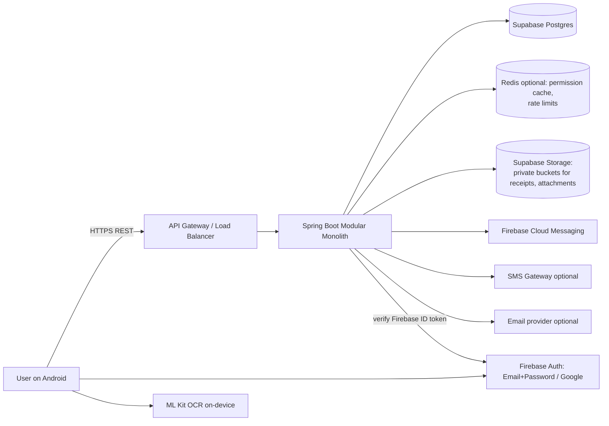
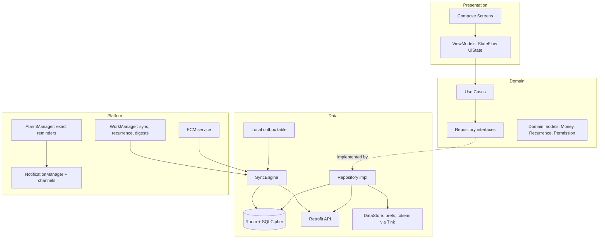
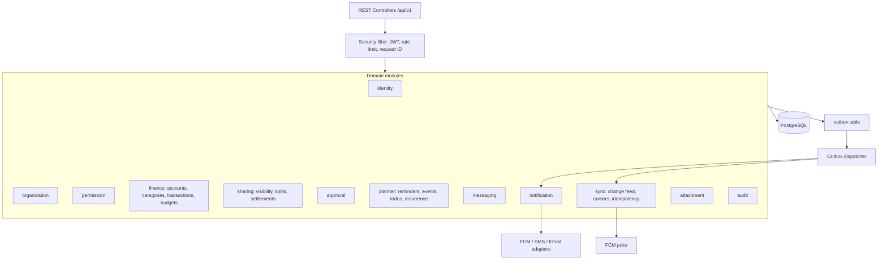
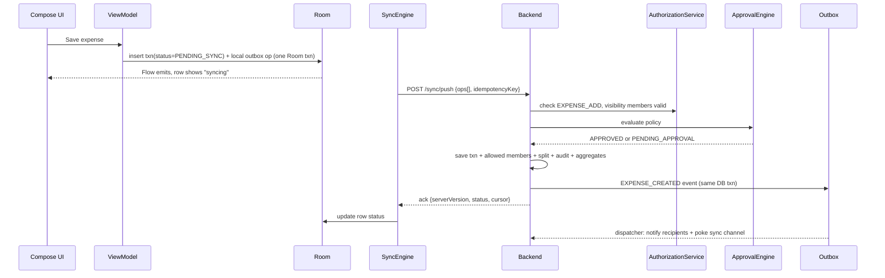
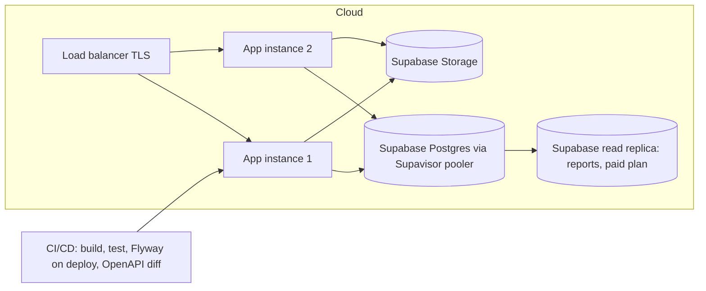

# 02 — High-Level Design (HLD)

App: Daily Money & Life Management (Android)
Applies the decisions in `01-ANALYSIS.md`.

---

## 1. System context



Key principle: **the server is the source of truth for shared data; the device is the
source of truth for un-synced local changes.** Personal-only R1 works fully offline.

---

## 2. Architecture style

| Layer | Style |
|---|---|
| Android | Clean Architecture + MVVM + UDF (unidirectional data flow), offline-first, multi-module |
| Backend | Modular monolith (Spring Modulith), hexagonal per module, REST; realtime pokes through FCM data messages |
| Data | **Supabase used only for data**: managed Postgres + Storage (no Supabase Auth, no Realtime). Only the backend connects; the app never holds Supabase keys. Flyway migrations, UUIDv7 keys, Row-Level Security as backstop |
| Async | Transactional outbox → in-process event dispatcher (later Kafka/SQS if scale needs) |

Why modular monolith: one deployable and one DB transaction boundary for money operations
(expense + split + audit + aggregate + outbox in one commit), while module boundaries keep
the door open to extract `notification` or `sync` later.

---

## 3. Android high-level architecture



Rules:
- UI reads **only from Room** (single source of truth). Network results are written to Room;
  the UI updates through `Flow`.
- Writes go to Room + local outbox in one Room transaction, then `SyncEngine` pushes.
- No business logic in Composables; ViewModels call use cases; use cases are pure Kotlin.

### 3.1 Gradle modules

```
:app                          (navigation host, DI graph, Application)
:core:model                   (pure Kotlin domain models, Money, Recurrence)
:core:domain                  (use cases, repository interfaces)
:core:data                    (repositories, mappers)
:core:database                (Room DB, DAOs, entities, migrations)
:core:network                 (Retrofit, OkHttp, Firebase ID-token interceptor)
:core:sync                    (SyncEngine, outbox, workers)
:core:notifications           (channels, local scheduler, FCM handling)
:core:designsystem            (theme, typography, reusable components, charts)
:core:common                  (dispatchers, result types, time/clock)
:core:security                (keystore, Tink, SQLCipher passphrase, biometric)
:feature:home
:feature:money                (transactions, accounts, categories, budgets, goals, debts, subscriptions)
:feature:reminders            (reminders + events + calendar)
:feature:todo
:feature:groups               (organizations, members, roles, permissions)
:feature:sharedexpense        (visibility, splits, settlements, approvals)
:feature:messages
:feature:notificationcenter
:feature:reports
:feature:settings
:feature:onboarding           (permissions primer; login lives in :feature:auth, see 04)
:baselineprofile              (macrobenchmark + baseline profile generator)
```

Feature modules depend on `:core:*` only, never on each other; cross-feature navigation goes
through route contracts in `:app`.

### 3.2 Tech choices (Android)

| Concern | Choice |
|---|---|
| Language / UI | Kotlin 2.x, Jetpack Compose, Material 3, adaptive layouts |
| DI | Hilt |
| Async | Coroutines + Flow |
| Local DB | Room (KSP) + SQLCipher (encrypted at rest) |
| Prefs / tokens | DataStore + Tink AEAD, key in Android Keystore |
| Network | Retrofit + OkHttp + kotlinx.serialization, certificate pinning |
| Background | WorkManager (sync, recurrence materializer, digests), AlarmManager (exact reminders) |
| Push | FCM data-only |
| Images | Coil 3 |
| OCR | ML Kit Text Recognition (on-device, no cloud) |
| Charts | Custom Compose `Canvas` |
| Paging | Paging 3 with Room `PagingSource` |
| SDK | minSdk 26, targetSdk 36 (Play requirement), compileSdk 37.1 (required by current AndroidX) |
| Quality | Detekt, ktlint, JUnit5, Turbine, Robolectric, Compose UI tests, Macrobenchmark |

---

## 4. Backend high-level architecture



Module rules:
- Modules talk through **published interfaces and domain events**, never each other's repositories.
- `permission` exposes `AuthorizationService` — the **only** place access decisions are made.
- `finance` / `sharing` / `approval` write their changes, audit rows, aggregate updates and
  outbox events in **one DB transaction**.

### 4.1 Tech choices (backend)

| Concern | Choice |
|---|---|
| Runtime | Java 21 LTS (or 25 LTS), Spring Boot 3.5+/4.x, virtual threads enabled |
| Modules | Spring Modulith (boundary verification tests) |
| Persistence | Spring Data JPA for writes, jOOQ / JDBC for report & feed queries |
| Migrations | Flyway in the backend (`backend/src/main/resources/db/migration`), runs on startup against Supabase Postgres; JPA `ddl-auto=validate` |
| Security | Spring Security resource server validating **Firebase ID tokens** (issuer `https://securetoken.google.com/<projectId>`, audience = projectId, Google public keys); Firebase owns sessions and refresh |
| Cache | Caffeine in-process first; Redis only when running > 1 instance (permissions, rate limits) |
| Realtime | FCM data messages `{type:SYNC, cursor}` (collapse key per user, so many changes = one wake-up); app also syncs on foreground |
| Files | Supabase Storage private buckets; backend issues signed URLs (5 min) after authorization; size/MIME limits on the bucket |
| Docs | springdoc-openapi → OpenAPI 3.1 contract |
| Observability | Micrometer + OpenTelemetry, structured JSON logs, request ID |
| Tests | JUnit5, local Supabase stack (`supabase start`) or Testcontainers Postgres with the migration files, ArchUnit/Modulith, RestAssured |

---

## 5. Core cross-cutting engines

These are reused by every organization type (Family, Friends, Office, Travel).

| Engine | Responsibility | Detail |
|---|---|---|
| **Authorization** | Membership + role + override + ownership + visibility | LLD §5 |
| **Approval** | INSTANT / REQUIRE_APPROVAL / CONDITIONAL state machine | LLD §7 |
| **Split & settlement** | Equal/percent/amount/share, rounding, balances | LLD §8 |
| **Recurrence** | RRULE parsing, occurrence materialization | LLD §9 |
| **Notification** | Event → recipients → preferences → channels → delivery log | LLD §10 |
| **Sync** | Outbox push, cursor pull, tombstones, idempotency, conflicts | LLD §6 |
| **Audit** | Append-only financial and permission change log | LLD §4.9 |

---

## 6. Key data flows

### 6.1 Create organization expense (online or offline)



### 6.2 Other members receive it

1. Outbox dispatcher resolves recipients = users who can see the expense (authorization engine).
2. Sync module writes a **feed entry** per affected org scope and sends `{"type":"SYNC","cursor":N}`
   through an FCM data message.
3. Device calls `GET /sync/pull?cursor=…`; server returns only rows the user may see, plus
   tombstones for rows no longer visible.
4. Notification module creates in-app notification + push per user preference.

### 6.3 Reminder fires (fully on-device)

WorkManager materializes next occurrences → AlarmManager exact alarm (if permitted) →
`BroadcastReceiver` builds the notification from Room with contextual actions
("Have you paid?") → action handled by a `BroadcastReceiver` → use case updates the occurrence
and offers "Create expense".

---

## 7. Security architecture (summary)

| Threat | Control |
|---|---|
| Broken auth | Firebase Auth (1-hour ID token, SDK refresh); backend validates signature, `aud`, `iss`, expiry on every call and rejects tokens issued before `users.tokens_valid_after` (revocation) |
| IDOR / cross-tenant | Every query scoped by authorization predicate; Postgres RLS on `transactions`, `attachments`, `expense_messages` as backstop |
| Privacy leak via push | Poke-only FCM data messages; lock-screen-safe notifications |
| Attachment leak | Private bucket, pre-signed URLs issued only after authz, 5-min expiry |
| Device theft | SQLCipher DB, Keystore-backed keys, optional biometric app lock, `FLAG_SECURE` on money screens (optional setting) |
| Abuse | Firebase Auth rate limits + App Check (Play Integrity); backend rate limits per user/endpoint; SMS per-org daily cap |
| Tampering / disputes | Append-only audit tables, no UPDATE/DELETE grants for app role |
| AI/data sharing | OCR on-device; cloud categorization only with explicit opt-in |

---

## 8. Deployment view



- Stateless app instances; pokes go out through FCM, so no sticky sessions or pub/sub.
- Spring Boot connects through Supavisor in **session mode** (port 5432), or transaction mode (6543) with `prepareThreshold=0`; the DB password and service-role key live only in server env vars.
- Our tables live in schema `app`, which is **not exposed** through Supabase's auto-generated Data API; the Android app never queries tables directly, only through Spring Boot. RLS is still enabled as a backstop.
- Outbox dispatcher uses `SELECT … FOR UPDATE SKIP LOCKED` so multiple instances share the work.
- Supabase daily backups (PITR add-on for production); report queries on a read replica once on a paid plan.

---

## 9. Non-functional targets ("optimised" made measurable)

| Metric | Target |
|---|---|
| Cold start (mid-range device) | < 1.0 s to first frame with Baseline Profile |
| Add-expense save (local) | < 50 ms; visible instantly offline |
| Dashboard render | 1 Room query per card, < 100 ms |
| List scroll | No jank frames > 16 ms in Macrobenchmark |
| APK download size | < 15 MB (R8 full mode, no heavy chart libs, ML Kit as optional module) |
| Background battery | No periodic work < 15 min; sync only on poke / user action / app open |
| API p95 latency | < 200 ms reads, < 300 ms writes |
| Sync pull | ≤ 500 changes per page, gzip, ETag |
| Availability | 99.9 % |
| Data durability | PITR 7 days, RPO ≤ 5 min |

---

## 10. Release slices

| Release | Backend needed? | Scope |
|---|---|---|
| R1 Personal MVP | No (local backup to Drive / file export) | Money, budgets, reports, reminders, events, to-do |
| R2 Groups | Yes | Auth, orgs, permissions, visibility, shared expenses, splits, settlements, sync |
| R3 Governance | Yes | Approval modes, messages, notification center & preferences, SMS |
| R4 Smart | Partial | OCR, statement import, categorization, optional SMS detection |

Each phase ends with the report in spec §26.
