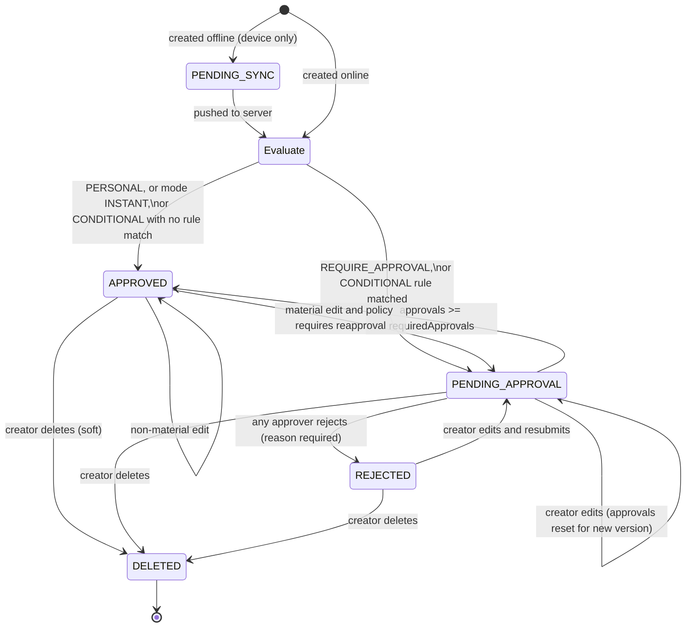
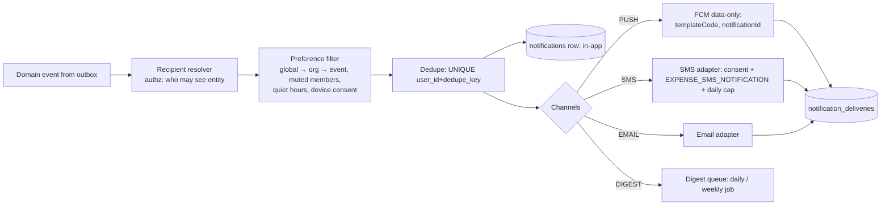
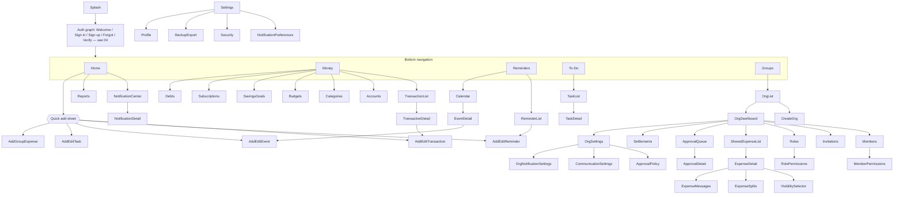

# 03 — Low-Level Design (LLD)

Covers the "first task" deliverables in spec §26: ER diagram, table definitions, permission
evaluation, approval state machine, API contract, Android navigation and screen architecture,
and task breakdown.

---

## 1. Conventions

| Topic | Rule |
|---|---|
| IDs | UUIDv7, generated **on the client** for offline-created rows (time-ordered, index-friendly, idempotent) |
| Money | `amount_minor BIGINT` + `currency CHAR(3)`. Exponent from ISO 4217 table (`INR`=2, `JPY`=0, `KWD`=3). Kotlin `@JvmInline value class Money(val minor: Long, val currency: CurrencyCode)`; Java `record Money(long minor, String currency)`. `BigDecimal` with `RoundingMode.HALF_EVEN` only inside percent/share math. |
| Time | Instants as `TIMESTAMPTZ` (UTC). Local dates for all-day items as `DATE` + `tz TEXT` (IANA). |
| Versioning | Every syncable row: `version INT`, `updated_at`, `deleted_at` (soft delete), `server_seq BIGINT` (global change sequence for sync). |
| Tenancy | Rows belong to either a user (`owner_user_id`, `org_id IS NULL`) or an org (`org_id NOT NULL`). |
| Audit | Financial and permission tables have append-only `*_audit` rows written in the same transaction. |
| Naming | snake_case in SQL, camelCase in JSON/Kotlin/Java. |

---

## 2. ER diagram (core)

```mermaid
erDiagram
    USERS ||--o{ ORGANIZATION_MEMBERS : joins
    ORGANIZATIONS ||--o{ ORGANIZATION_MEMBERS : has
    ORGANIZATIONS ||--o{ ORGANIZATION_ROLES : defines
    ORGANIZATION_ROLES ||--o{ ROLE_PERMISSIONS : grants
    ORGANIZATION_MEMBERS ||--o{ MEMBER_PERMISSIONS : overrides
    ORGANIZATION_MEMBERS }o--|| ORGANIZATION_ROLES : "has role"
    ORGANIZATIONS ||--o{ ORGANIZATION_INVITATIONS : sends
    ORGANIZATIONS ||--|| ORG_APPROVAL_POLICIES : configures
    ORG_APPROVAL_POLICIES ||--o{ APPROVAL_RULES : contains
    ORGANIZATIONS ||--o{ ORGANIZATION_APPROVERS : names

    USERS ||--o{ ACCOUNTS : owns
    USERS ||--o{ CATEGORIES : "custom (personal)"
    ORGANIZATIONS ||--o{ CATEGORIES : "custom (org)"
    USERS ||--o{ TRANSACTIONS : creates
    ORGANIZATIONS ||--o{ TRANSACTIONS : scopes
    ACCOUNTS ||--o{ TRANSACTIONS : "paid from"
    CATEGORIES ||--o{ TRANSACTIONS : classifies
    TRANSACTIONS ||--o{ EXPENSE_ALLOWED_MEMBERS : "visible to"
    TRANSACTIONS ||--o{ EXPENSE_SPLITS : "split into"
    TRANSACTIONS ||--o{ EXPENSE_APPROVALS : "approval history"
    TRANSACTIONS ||--o{ TRANSACTION_AUDIT : audited
    TRANSACTIONS ||--o{ EXPENSE_MESSAGES : discussed
    TRANSACTIONS ||--o{ ATTACHMENTS : "has files"
    ORGANIZATIONS ||--o{ SETTLEMENTS : records

    USERS ||--o{ REMINDERS : owns
    REMINDERS ||--o{ REMINDER_OCCURRENCES : materializes
    USERS ||--o{ EVENTS : owns
    EVENTS ||--o{ EVENT_PARTICIPANTS : invites
    EVENTS ||--o{ REMINDERS : "prep tasks"
    USERS ||--o{ TODOS : owns
    TODOS ||--o{ TODO_CHECKLIST_ITEMS : contains

    USERS ||--o{ NOTIFICATIONS : receives
    USERS ||--o{ NOTIFICATION_PREFERENCES : configures
    NOTIFICATIONS ||--o{ NOTIFICATION_DELIVERIES : "delivered via"

    USERS ||--o{ BUDGETS : sets
    USERS ||--o{ SAVINGS_GOALS : sets
    USERS ||--o{ SUBSCRIPTIONS : tracks
    USERS ||--o{ DEBTS : tracks
```



Consolidations vs spec §19 (same features, fewer tables):

| Spec tables | Consolidated into |
|---|---|
| `notification_preferences`, `notification_category_settings`, `member_notification_settings`, `member_communication_settings` | `notification_preferences` (scope = GLOBAL / ORG / MUTE_MEMBER, key = category or event) |
| `organization_notification_settings` | `organizations.settings JSONB` |
| `notification_schedules`, `notification_actions`, `notification_templates` | `notification_templates` (actions as JSONB), schedules handled by reminder occurrences |
| `expense_message_recipients`, `expense_message_audit` | `message_receipts` + generic `audit_log` |
| `reminder_history` | `reminder_occurrences` (status + completed fields) |
| `todo_checklists` | `todo_checklist_items` |

---

## 3. Enumerations

```
TransactionType      : DEBIT, CREDIT, TRANSFER
Visibility           : PERSONAL, ORGANIZATION, SELECTED_MEMBERS
ApprovalStatus       : APPROVED, PENDING_APPROVAL, REJECTED            (server)
LocalSyncStatus      : SYNCED, PENDING_SYNC, SYNC_FAILED, CONFLICT      (device only)
TransactionSource    : MANUAL, RECURRING, OCR, STATEMENT_IMPORT, UPI_SHARE, SMS, REMINDER
PaymentMethod        : CASH, UPI, CARD, BANK_TRANSFER, WALLET, OTHER
AccountType          : CASH, BANK, UPI, CREDIT_CARD, WALLET, LOAN
ApprovalMode         : INSTANT, REQUIRE_APPROVAL, CONDITIONAL
MemberStatus         : INVITED, ACTIVE, REMOVED, LEFT
SystemRole           : OWNER, ADMIN, MEMBER, VIEWER   (+ custom roles)
OverrideEffect       : ALLOW, DENY
SplitMethod          : EQUAL, PERCENT, AMOUNT, SHARES
ReminderKind         : BILL, EMI, CREDIT_CARD, INSURANCE, SUBSCRIPTION, COLLECTION,
                       BIRTHDAY, ANNIVERSARY, APPOINTMENT, MEETING, TRAVEL, EXAM, TASK, CUSTOM
OccurrenceStatus     : UPCOMING, DUE, OVERDUE, SNOOZED, DONE, SKIPPED
TodoPriority         : LOW, MEDIUM, HIGH
NotificationPriority : CRITICAL, HIGH, NORMAL, LOW
Channel              : PUSH, IN_APP, LOCAL, EMAIL, SMS
```

---

## 4. PostgreSQL table definitions (Flyway migrations on Supabase Postgres, schema `app`)

All tables below are created in schema `app` (`SET search_path = app`), not `public`, so Supabase's
Data API does not expose them. Identity comes from **Firebase Auth**; Supabase Auth is not used.

### 4.1 Identity & organization

```sql
CREATE TABLE users (
  id              UUID PRIMARY KEY,                     -- internal id
  firebase_uid    TEXT UNIQUE NOT NULL,                 -- Firebase Auth uid (token 'sub')
  email_verified  BOOLEAN NOT NULL DEFAULT false,
  auth_providers  TEXT[] NOT NULL DEFAULT '{}',         -- password, google.com
  tokens_valid_after TIMESTAMPTZ,                       -- reject ID tokens issued earlier (logout-all)
  display_name    TEXT NOT NULL,
  email           CITEXT UNIQUE,
  phone_e164      TEXT UNIQUE,
  default_currency CHAR(3) NOT NULL DEFAULT 'INR',
  time_zone       TEXT NOT NULL DEFAULT 'Asia/Kolkata',
  status          TEXT NOT NULL DEFAULT 'ACTIVE',       -- ACTIVE, DELETED
  created_at      TIMESTAMPTZ NOT NULL DEFAULT now(),
  deleted_at      TIMESTAMPTZ
);

CREATE TABLE devices (
  id          UUID PRIMARY KEY,
  user_id     UUID NOT NULL REFERENCES users(id),
  fcm_token   TEXT,
  platform    TEXT NOT NULL DEFAULT 'ANDROID',
  app_version TEXT,
  last_seen_at TIMESTAMPTZ NOT NULL DEFAULT now()
);

-- Sessions and refresh tokens are owned by Firebase Auth. The profile row is created by
-- POST /me/bootstrap (upsert on firebase_uid) the first time a signed-in user calls the backend.

CREATE TABLE organizations (
  id            UUID PRIMARY KEY,
  name          TEXT NOT NULL,
  kind          TEXT NOT NULL,                 -- FAMILY, FRIENDS, OFFICE, TRAVEL, OTHER
  currency      CHAR(3) NOT NULL,
  settings      JSONB NOT NULL DEFAULT '{}',   -- notification + communication defaults
  created_by    UUID NOT NULL REFERENCES users(id),
  version       INT NOT NULL DEFAULT 1,
  created_at    TIMESTAMPTZ NOT NULL DEFAULT now(),
  updated_at    TIMESTAMPTZ NOT NULL DEFAULT now(),
  deleted_at    TIMESTAMPTZ
);

CREATE TABLE organization_roles (
  id          UUID PRIMARY KEY,
  org_id      UUID NOT NULL REFERENCES organizations(id),
  code        TEXT NOT NULL,                   -- OWNER/ADMIN/MEMBER/VIEWER or custom
  name        TEXT NOT NULL,
  is_system   BOOLEAN NOT NULL DEFAULT false,
  UNIQUE (org_id, code)
);

CREATE TABLE organization_members (
  org_id       UUID NOT NULL REFERENCES organizations(id),
  user_id      UUID NOT NULL REFERENCES users(id),
  role_id      UUID NOT NULL REFERENCES organization_roles(id),
  status       TEXT NOT NULL,                  -- ACTIVE, REMOVED, LEFT
  perm_version INT NOT NULL DEFAULT 1,         -- bump to invalidate permission cache
  joined_at    TIMESTAMPTZ NOT NULL DEFAULT now(),
  removed_at   TIMESTAMPTZ,
  PRIMARY KEY (org_id, user_id)
);
CREATE INDEX ix_members_user_active ON organization_members(user_id) WHERE status = 'ACTIVE';

CREATE TABLE organization_invitations (
  id           UUID PRIMARY KEY,
  org_id       UUID NOT NULL REFERENCES organizations(id),
  invited_by   UUID NOT NULL REFERENCES users(id),
  invitee_contact TEXT NOT NULL,               -- email or E.164 phone
  role_id      UUID NOT NULL REFERENCES organization_roles(id),
  token_hash   BYTEA NOT NULL,
  status       TEXT NOT NULL,                  -- PENDING, ACCEPTED, DECLINED, EXPIRED, REVOKED
  expires_at   TIMESTAMPTZ NOT NULL,
  created_at   TIMESTAMPTZ NOT NULL DEFAULT now()
);
```

### 4.2 Permissions

```sql
CREATE TABLE permission_definitions (
  code        TEXT PRIMARY KEY,                -- EXPENSE_VIEW …
  bit         SMALLINT UNIQUE NOT NULL,        -- position in effective bitmask (0..63)
  module      TEXT NOT NULL,
  description TEXT NOT NULL
);

CREATE TABLE role_permissions (
  role_id     UUID NOT NULL REFERENCES organization_roles(id),
  perm_code   TEXT NOT NULL REFERENCES permission_definitions(code),
  PRIMARY KEY (role_id, perm_code)
);

CREATE TABLE member_permissions (
  org_id      UUID NOT NULL,
  user_id     UUID NOT NULL,
  perm_code   TEXT NOT NULL REFERENCES permission_definitions(code),
  effect      TEXT NOT NULL CHECK (effect IN ('ALLOW','DENY')),
  set_by      UUID NOT NULL REFERENCES users(id),
  set_at      TIMESTAMPTZ NOT NULL DEFAULT now(),
  PRIMARY KEY (org_id, user_id, perm_code),
  FOREIGN KEY (org_id, user_id) REFERENCES organization_members(org_id, user_id)
);
```

Seeded permission codes (bit order): `EXPENSE_VIEW`, `EXPENSE_ADD`, `EXPENSE_EDIT_OWN`,
`EXPENSE_DELETE_OWN`, `EXPENSE_APPROVE`, `EXPENSE_SPLIT_MANAGE`, `EXPENSE_REPORT_VIEW`,
`EXPENSE_BUDGET_MANAGE`, `MEMBER_INVITE`, `MEMBER_MANAGE`, `PERMISSION_MANAGE`,
`ORGANIZATION_SETTINGS_MANAGE`, `EXPENSE_MESSAGE_SEND`, `EXPENSE_MESSAGE_RECEIVE`,
`EXPENSE_MESSAGE_REPLY`, `EXPENSE_NOTIFICATION_RECEIVE`, `EXPENSE_SMS_SEND`,
`EXPENSE_SMS_NOTIFICATION`, `EXPENSE_MESSAGE_ATTACH`, `REMINDER_MANAGE`, `EVENT_MANAGE`,
`TASK_MANAGE`, `TASK_ASSIGN`, `ATTACHMENT_VIEW`. There is intentionally **no** `EXPENSE_EDIT_ALL`.

### 4.3 Finance

```sql
CREATE TABLE accounts (
  id            UUID PRIMARY KEY,
  owner_user_id UUID NOT NULL REFERENCES users(id),
  name          TEXT NOT NULL,
  type          TEXT NOT NULL,
  currency      CHAR(3) NOT NULL,
  opening_minor BIGINT NOT NULL DEFAULT 0,
  archived      BOOLEAN NOT NULL DEFAULT false,
  version INT NOT NULL DEFAULT 1, server_seq BIGINT NOT NULL,
  updated_at TIMESTAMPTZ NOT NULL DEFAULT now(), deleted_at TIMESTAMPTZ
);

CREATE TABLE categories (
  id            UUID PRIMARY KEY,
  owner_user_id UUID REFERENCES users(id),     -- NULL + org NULL => system default
  org_id        UUID REFERENCES organizations(id),
  parent_id     UUID REFERENCES categories(id),
  name          TEXT NOT NULL,
  kind          TEXT NOT NULL,                 -- EXPENSE, INCOME
  icon          TEXT, color TEXT,
  version INT NOT NULL DEFAULT 1, server_seq BIGINT NOT NULL,
  updated_at TIMESTAMPTZ NOT NULL DEFAULT now(), deleted_at TIMESTAMPTZ,
  CHECK (NOT (owner_user_id IS NOT NULL AND org_id IS NOT NULL))
);

CREATE TABLE transactions (
  id              UUID PRIMARY KEY,                       -- client-generated UUIDv7
  creator_id      UUID NOT NULL REFERENCES users(id),     -- owner == creator
  org_id          UUID REFERENCES organizations(id),
  type            TEXT NOT NULL,                          -- DEBIT, CREDIT, TRANSFER
  amount_minor    BIGINT NOT NULL CHECK (amount_minor > 0),
  currency        CHAR(3) NOT NULL,
  category_id     UUID REFERENCES categories(id),
  account_id      UUID REFERENCES accounts(id),           -- creator's own account only
  to_account_id   UUID REFERENCES accounts(id),           -- TRANSFER only
  occurred_at     TIMESTAMPTZ NOT NULL,
  description     TEXT,
  merchant        TEXT,
  payment_method  TEXT,
  visibility      TEXT NOT NULL DEFAULT 'PERSONAL',
  approval_status TEXT NOT NULL DEFAULT 'APPROVED',
  source          TEXT NOT NULL DEFAULT 'MANUAL',
  dedupe_hash     TEXT,                                   -- for import/OCR/SMS dedupe
  recurring_rule_id UUID,
  version         INT NOT NULL DEFAULT 1,
  server_seq      BIGINT NOT NULL,
  created_at      TIMESTAMPTZ NOT NULL DEFAULT now(),
  updated_at      TIMESTAMPTZ NOT NULL DEFAULT now(),
  deleted_at      TIMESTAMPTZ,
  CHECK (org_id IS NOT NULL OR visibility = 'PERSONAL'),
  CHECK (org_id IS NOT NULL OR approval_status = 'APPROVED')
);
CREATE INDEX ix_txn_creator_date ON transactions(creator_id, occurred_at DESC) WHERE deleted_at IS NULL;
CREATE INDEX ix_txn_org_date     ON transactions(org_id, occurred_at DESC)
       WHERE org_id IS NOT NULL AND deleted_at IS NULL;
CREATE INDEX ix_txn_seq          ON transactions(server_seq);
CREATE UNIQUE INDEX ux_txn_dedupe ON transactions(creator_id, dedupe_hash) WHERE dedupe_hash IS NOT NULL AND deleted_at IS NULL;

CREATE TABLE expense_allowed_members (
  transaction_id UUID NOT NULL REFERENCES transactions(id),
  user_id        UUID NOT NULL REFERENCES users(id),
  PRIMARY KEY (transaction_id, user_id)
);
CREATE INDEX ix_eam_user ON expense_allowed_members(user_id);

CREATE TABLE budgets (
  id UUID PRIMARY KEY,
  owner_user_id UUID REFERENCES users(id),
  org_id        UUID REFERENCES organizations(id),
  category_id   UUID REFERENCES categories(id),       -- NULL = overall
  period        TEXT NOT NULL,                         -- MONTHLY, WEEKLY, YEARLY
  limit_minor   BIGINT NOT NULL,
  currency      CHAR(3) NOT NULL,
  alert_levels  SMALLINT[] NOT NULL DEFAULT '{50,75,90,100}',
  version INT NOT NULL DEFAULT 1, server_seq BIGINT NOT NULL,
  updated_at TIMESTAMPTZ NOT NULL DEFAULT now(), deleted_at TIMESTAMPTZ
);

CREATE TABLE savings_goals (
  id UUID PRIMARY KEY, owner_user_id UUID NOT NULL REFERENCES users(id),
  name TEXT NOT NULL, target_minor BIGINT NOT NULL, saved_minor BIGINT NOT NULL DEFAULT 0,
  currency CHAR(3) NOT NULL, target_date DATE,
  version INT NOT NULL DEFAULT 1, server_seq BIGINT NOT NULL,
  updated_at TIMESTAMPTZ NOT NULL DEFAULT now(), deleted_at TIMESTAMPTZ
);

CREATE TABLE subscriptions (
  id UUID PRIMARY KEY, owner_user_id UUID NOT NULL REFERENCES users(id),
  name TEXT NOT NULL, amount_minor BIGINT NOT NULL, currency CHAR(3) NOT NULL,
  rrule TEXT NOT NULL, next_due DATE NOT NULL, reminder_id UUID,
  version INT NOT NULL DEFAULT 1, server_seq BIGINT NOT NULL,
  updated_at TIMESTAMPTZ NOT NULL DEFAULT now(), deleted_at TIMESTAMPTZ
);

CREATE TABLE debts (                                   -- debt & lending tracker
  id UUID PRIMARY KEY, owner_user_id UUID NOT NULL REFERENCES users(id),
  counterparty TEXT NOT NULL, direction TEXT NOT NULL,  -- LENT, BORROWED
  principal_minor BIGINT NOT NULL, repaid_minor BIGINT NOT NULL DEFAULT 0,
  currency CHAR(3) NOT NULL, due_date DATE,
  version INT NOT NULL DEFAULT 1, server_seq BIGINT NOT NULL,
  updated_at TIMESTAMPTZ NOT NULL DEFAULT now(), deleted_at TIMESTAMPTZ
);

CREATE TABLE recurring_rules (                         -- recurring transactions
  id UUID PRIMARY KEY, owner_user_id UUID NOT NULL REFERENCES users(id),
  template JSONB NOT NULL,                             -- transaction fields
  rrule TEXT NOT NULL, dtstart TIMESTAMPTZ NOT NULL, tz TEXT NOT NULL,
  next_run_at TIMESTAMPTZ NOT NULL, auto_post BOOLEAN NOT NULL DEFAULT false,
  version INT NOT NULL DEFAULT 1, server_seq BIGINT NOT NULL,
  updated_at TIMESTAMPTZ NOT NULL DEFAULT now(), deleted_at TIMESTAMPTZ
);
```

### 4.4 Sharing: splits & settlements

```sql
CREATE TABLE expense_splits (
  transaction_id UUID NOT NULL REFERENCES transactions(id),
  user_id        UUID NOT NULL REFERENCES users(id),
  method         TEXT NOT NULL,                       -- EQUAL, PERCENT, AMOUNT, SHARES
  input_value    NUMERIC(12,4),                       -- percent or share count as entered
  share_minor    BIGINT NOT NULL CHECK (share_minor >= 0),
  settled_minor  BIGINT NOT NULL DEFAULT 0 CHECK (settled_minor >= 0),
  PRIMARY KEY (transaction_id, user_id),
  CHECK (settled_minor <= share_minor)
);
-- Sum invariant enforced in service + deferred constraint trigger:
-- SUM(share_minor) = transactions.amount_minor for every split transaction.

CREATE TABLE settlements (
  id             UUID PRIMARY KEY,
  org_id         UUID NOT NULL REFERENCES organizations(id),
  payer_id       UUID NOT NULL REFERENCES users(id),   -- who pays the debt
  receiver_id    UUID NOT NULL REFERENCES users(id),
  amount_minor   BIGINT NOT NULL CHECK (amount_minor > 0),
  currency       CHAR(3) NOT NULL,
  method         TEXT NOT NULL,                        -- CASH, UPI, BANK, OTHER
  status         TEXT NOT NULL,                        -- REQUESTED, CONFIRMED, CANCELLED
  external_ref   TEXT,                                 -- UPI txn ref if user provides
  confirmed_by   UUID REFERENCES users(id),            -- receiver confirms
  created_by     UUID NOT NULL REFERENCES users(id),
  created_at     TIMESTAMPTZ NOT NULL DEFAULT now(),
  confirmed_at   TIMESTAMPTZ,
  server_seq     BIGINT NOT NULL,
  CHECK (payer_id <> receiver_id)
);

CREATE TABLE settlement_allocations (                  -- which split rows a settlement pays
  settlement_id  UUID NOT NULL REFERENCES settlements(id),
  transaction_id UUID NOT NULL,
  user_id        UUID NOT NULL,
  amount_minor   BIGINT NOT NULL,
  PRIMARY KEY (settlement_id, transaction_id, user_id),
  FOREIGN KEY (transaction_id, user_id) REFERENCES expense_splits(transaction_id, user_id)
);
```

### 4.5 Approval

```sql
CREATE TABLE org_approval_policies (
  org_id               UUID PRIMARY KEY REFERENCES organizations(id),
  mode                 TEXT NOT NULL DEFAULT 'INSTANT',
  allow_self_approval  BOOLEAN NOT NULL DEFAULT false,
  required_approvals   SMALLINT NOT NULL DEFAULT 1,
  reapprove_on_material_change BOOLEAN NOT NULL DEFAULT true,
  version INT NOT NULL DEFAULT 1, updated_at TIMESTAMPTZ NOT NULL DEFAULT now()
);

CREATE TABLE approval_rules (
  id          UUID PRIMARY KEY,
  org_id      UUID NOT NULL REFERENCES organizations(id),
  priority    SMALLINT NOT NULL,
  rule_type   TEXT NOT NULL,      -- AMOUNT_GTE, CATEGORY_IN, CREATOR_IN, MEMBER_SELECTED
  params      JSONB NOT NULL,     -- {"amountMinor":500000} / {"categoryIds":[...]}
  enabled     BOOLEAN NOT NULL DEFAULT true
);

CREATE TABLE organization_approvers (
  org_id   UUID NOT NULL, user_id UUID NOT NULL,
  PRIMARY KEY (org_id, user_id),
  FOREIGN KEY (org_id, user_id) REFERENCES organization_members(org_id, user_id)
);

CREATE TABLE expense_approvals (                       -- append-only history
  id             UUID PRIMARY KEY,
  transaction_id UUID NOT NULL REFERENCES transactions(id),
  txn_version    INT NOT NULL,                         -- version decided on
  approver_id    UUID NOT NULL REFERENCES users(id),
  decision       TEXT NOT NULL,                        -- APPROVED, REJECTED
  reason         TEXT,
  decided_at     TIMESTAMPTZ NOT NULL DEFAULT now(),
  UNIQUE (transaction_id, txn_version, approver_id)
);
```

### 4.6 Planner: reminders, events, to-dos

```sql
CREATE TABLE reminders (
  id            UUID PRIMARY KEY,
  owner_user_id UUID NOT NULL REFERENCES users(id),
  org_id        UUID REFERENCES organizations(id),
  kind          TEXT NOT NULL,
  title         TEXT NOT NULL,
  notes         TEXT,
  amount_minor  BIGINT, currency CHAR(3),            -- bills
  event_id      UUID,                                -- preparation reminders
  dtstart       TIMESTAMPTZ NOT NULL,
  tz            TEXT NOT NULL,
  all_day       BOOLEAN NOT NULL DEFAULT false,
  rrule         TEXT,                                -- NULL = one-time
  alert_offsets INT[] NOT NULL DEFAULT '{0}',        -- minutes before, e.g. {4320,1440,0}
  location      JSONB,                               -- {lat,lng,radiusM} geofence
  notify_user_ids UUID[] NOT NULL DEFAULT '{}',      -- selected members (org)
  version INT NOT NULL DEFAULT 1, server_seq BIGINT NOT NULL,
  updated_at TIMESTAMPTZ NOT NULL DEFAULT now(), deleted_at TIMESTAMPTZ
);

CREATE TABLE reminder_occurrences (                  -- also the completion history
  reminder_id   UUID NOT NULL REFERENCES reminders(id),
  occurs_at     TIMESTAMPTZ NOT NULL,                -- original slot (identity)
  status        TEXT NOT NULL DEFAULT 'UPCOMING',
  snoozed_until TIMESTAMPTZ,
  rescheduled_to TIMESTAMPTZ,
  completed_at  TIMESTAMPTZ,
  completed_by  UUID REFERENCES users(id),
  paid_amount_minor BIGINT,
  linked_transaction_id UUID REFERENCES transactions(id),
  server_seq BIGINT NOT NULL,
  PRIMARY KEY (reminder_id, occurs_at)
);

CREATE TABLE events (
  id UUID PRIMARY KEY, owner_user_id UUID NOT NULL REFERENCES users(id),
  org_id UUID REFERENCES organizations(id),
  type TEXT NOT NULL, title TEXT NOT NULL, description TEXT,
  starts_at TIMESTAMPTZ NOT NULL, ends_at TIMESTAMPTZ, all_day BOOLEAN NOT NULL DEFAULT false,
  tz TEXT NOT NULL, rrule TEXT, location TEXT, related_contacts JSONB,
  status TEXT NOT NULL DEFAULT 'SCHEDULED',
  version INT NOT NULL DEFAULT 1, server_seq BIGINT NOT NULL,
  updated_at TIMESTAMPTZ NOT NULL DEFAULT now(), deleted_at TIMESTAMPTZ
);

CREATE TABLE event_participants (
  event_id UUID NOT NULL REFERENCES events(id), user_id UUID NOT NULL REFERENCES users(id),
  rsvp TEXT NOT NULL DEFAULT 'PENDING', PRIMARY KEY (event_id, user_id)
);

CREATE TABLE todos (
  id UUID PRIMARY KEY, owner_user_id UUID NOT NULL REFERENCES users(id),
  org_id UUID REFERENCES organizations(id), assignee_id UUID REFERENCES users(id),
  title TEXT NOT NULL, notes TEXT, category TEXT, priority TEXT NOT NULL DEFAULT 'MEDIUM',
  start_date DATE, due_at TIMESTAMPTZ, rrule TEXT,
  completed_at TIMESTAMPTZ, parent_id UUID REFERENCES todos(id),   -- subtasks
  version INT NOT NULL DEFAULT 1, server_seq BIGINT NOT NULL,
  updated_at TIMESTAMPTZ NOT NULL DEFAULT now(), deleted_at TIMESTAMPTZ
);

CREATE TABLE todo_checklist_items (
  id UUID PRIMARY KEY, todo_id UUID NOT NULL REFERENCES todos(id),
  text TEXT NOT NULL, done BOOLEAN NOT NULL DEFAULT false, position INT NOT NULL
);
```

Completion percentage = done checklist items / total (computed, not stored).

### 4.7 Notifications (consolidated)

```sql
CREATE TABLE notification_templates (
  code        TEXT PRIMARY KEY,                 -- EXPENSE_CREATED, APPROVAL_REQUESTED …
  category    TEXT NOT NULL,                    -- MONEY, REMINDER, EVENT, TODO, ORG, SHARED_EXPENSE,
                                                -- APPROVAL, SPLIT, SETTLEMENT, MESSAGE, BUDGET,
                                                -- SUBSCRIPTION, SYSTEM
  default_priority TEXT NOT NULL,
  title_key   TEXT NOT NULL, body_key TEXT NOT NULL,   -- i18n keys with {placeholders}
  actions     JSONB NOT NULL DEFAULT '[]'       -- [{"code":"APPROVE","perm":"EXPENSE_APPROVE"}]
);

CREATE TABLE notifications (
  id            UUID PRIMARY KEY,
  user_id       UUID NOT NULL REFERENCES users(id),
  org_id        UUID REFERENCES organizations(id),
  template_code TEXT NOT NULL REFERENCES notification_templates(code),
  priority      TEXT NOT NULL,
  entity_type   TEXT, entity_id UUID,           -- resolved & authz-checked on open
  params        JSONB NOT NULL DEFAULT '{}',    -- non-sensitive placeholders only
  dedupe_key    TEXT NOT NULL,                  -- e.g. "APPROVAL_REQUESTED:{txnId}:{version}"
  read_at       TIMESTAMPTZ, archived_at TIMESTAMPTZ,
  created_at    TIMESTAMPTZ NOT NULL DEFAULT now(),
  server_seq    BIGINT NOT NULL,
  UNIQUE (user_id, dedupe_key)
);
CREATE INDEX ix_notif_user_unread ON notifications(user_id, created_at DESC) WHERE read_at IS NULL AND archived_at IS NULL;

CREATE TABLE notification_preferences (
  user_id   UUID NOT NULL REFERENCES users(id),
  scope     TEXT NOT NULL,                      -- GLOBAL, ORG, MUTE_MEMBER
  scope_id  UUID NOT NULL DEFAULT '00000000-0000-0000-0000-000000000000', -- org or muted user
  key       TEXT NOT NULL,                      -- '*', category, or template code
  push BOOLEAN, in_app BOOLEAN, email BOOLEAN, sms BOOLEAN,
  sound BOOLEAN, vibrate BOOLEAN, priority TEXT, muted_until TIMESTAMPTZ,
  PRIMARY KEY (user_id, scope, scope_id, key)
);
-- quiet hours, digests, badges live in users.settings JSONB (one row per user, few fields)

CREATE TABLE notification_deliveries (
  id              UUID PRIMARY KEY,
  notification_id UUID NOT NULL REFERENCES notifications(id),
  channel         TEXT NOT NULL,
  status          TEXT NOT NULL,                -- QUEUED, SENT, DELIVERED, FAILED, SUPPRESSED
  provider_ref    TEXT, error TEXT,
  attempts        SMALLINT NOT NULL DEFAULT 0,
  updated_at      TIMESTAMPTZ NOT NULL DEFAULT now()
);

CREATE TABLE sms_consents (
  user_id UUID NOT NULL REFERENCES users(id), org_id UUID NOT NULL REFERENCES organizations(id),
  phone_e164 TEXT NOT NULL, consented_at TIMESTAMPTZ NOT NULL, revoked_at TIMESTAMPTZ,
  PRIMARY KEY (user_id, org_id)
);
```

### 4.8 Messaging

```sql
CREATE TABLE expense_messages (
  id             UUID PRIMARY KEY,
  transaction_id UUID NOT NULL REFERENCES transactions(id),
  org_id         UUID NOT NULL REFERENCES organizations(id),
  sender_id      UUID NOT NULL REFERENCES users(id),
  parent_id      UUID REFERENCES expense_messages(id),
  body           TEXT NOT NULL CHECK (length(body) <= 4000),
  created_at     TIMESTAMPTZ NOT NULL DEFAULT now(),
  edited_at      TIMESTAMPTZ, deleted_at TIMESTAMPTZ,
  server_seq     BIGINT NOT NULL
);
CREATE INDEX ix_msg_txn ON expense_messages(transaction_id, created_at);

CREATE TABLE message_receipts (
  message_id UUID NOT NULL REFERENCES expense_messages(id),
  user_id    UUID NOT NULL REFERENCES users(id),
  delivered_at TIMESTAMPTZ, read_at TIMESTAMPTZ,
  PRIMARY KEY (message_id, user_id)
);
```

### 4.9 Attachments, audit, sync, outbox

```sql
CREATE TABLE attachments (
  id           UUID PRIMARY KEY,
  owner_user_id UUID NOT NULL REFERENCES users(id),
  entity_type  TEXT NOT NULL,          -- TRANSACTION, MESSAGE, REMINDER, EVENT, TODO
  entity_id    UUID NOT NULL,
  storage_key  TEXT NOT NULL,
  mime_type    TEXT NOT NULL, size_bytes BIGINT NOT NULL CHECK (size_bytes <= 10485760),
  sha256       BYTEA NOT NULL,
  scan_status  TEXT NOT NULL DEFAULT 'PENDING',
  created_at   TIMESTAMPTZ NOT NULL DEFAULT now(), deleted_at TIMESTAMPTZ
);
-- Access = access to the parent entity. Never a standalone permission check.

CREATE TABLE audit_log (                         -- append-only, partitioned monthly
  id          BIGSERIAL,
  occurred_at TIMESTAMPTZ NOT NULL DEFAULT now(),
  actor_id    UUID NOT NULL,
  org_id      UUID,
  entity_type TEXT NOT NULL, entity_id UUID NOT NULL,
  action      TEXT NOT NULL,                    -- CREATE, UPDATE, DELETE, VISIBILITY, APPROVE, PERM_CHANGE…
  before      JSONB, after JSONB,
  request_id  TEXT,
  PRIMARY KEY (id, occurred_at)
) PARTITION BY RANGE (occurred_at);
REVOKE UPDATE, DELETE ON audit_log FROM app_role;

CREATE SEQUENCE server_seq_gen;                  -- global monotonic change sequence

CREATE TABLE sync_feed (                         -- what changed, per scope
  seq         BIGINT PRIMARY KEY,                -- = server_seq of the change
  scope_type  TEXT NOT NULL,                     -- USER, ORG
  scope_id    UUID NOT NULL,
  entity_type TEXT NOT NULL,
  entity_id   UUID NOT NULL,
  op          TEXT NOT NULL,                     -- UPSERT, DELETE, REVOKE
  target_user UUID                               -- set for REVOKE tombstones (per-user)
);
CREATE INDEX ix_feed_scope ON sync_feed(scope_type, scope_id, seq);

CREATE TABLE idempotency_keys (
  user_id UUID NOT NULL, key UUID NOT NULL,
  response JSONB NOT NULL, created_at TIMESTAMPTZ NOT NULL DEFAULT now(),
  PRIMARY KEY (user_id, key)
);                                               -- purge after 7 days

CREATE TABLE outbox_events (
  id           BIGSERIAL PRIMARY KEY,
  event_type   TEXT NOT NULL,
  aggregate_id UUID NOT NULL,
  payload      JSONB NOT NULL,
  created_at   TIMESTAMPTZ NOT NULL DEFAULT now(),
  processed_at TIMESTAMPTZ,
  attempts     SMALLINT NOT NULL DEFAULT 0
);
CREATE INDEX ix_outbox_pending ON outbox_events(id) WHERE processed_at IS NULL;
```

### 4.10 Aggregates (fast dashboards)

```sql
CREATE TABLE monthly_aggregates (
  scope_type   TEXT NOT NULL,       -- USER, ORG, ORG_MEMBER
  scope_id     UUID NOT NULL,       -- user id, org id, or org id (with member_id)
  member_id    UUID NOT NULL DEFAULT '00000000-0000-0000-0000-000000000000',
  month        DATE NOT NULL,       -- first day of month
  category_id  UUID NOT NULL DEFAULT '00000000-0000-0000-0000-000000000000',
  currency     CHAR(3) NOT NULL,
  debit_minor  BIGINT NOT NULL DEFAULT 0,
  credit_minor BIGINT NOT NULL DEFAULT 0,
  pending_minor BIGINT NOT NULL DEFAULT 0,
  PRIMARY KEY (scope_type, scope_id, member_id, month, category_id, currency)
);
```

Org aggregates include only `visibility = ORGANIZATION` + `APPROVED` rows (safe for every
member with `EXPENSE_REPORT_VIEW`). `SELECTED_MEMBERS` rows are added at query time for the
viewer (small set, indexed via `ix_eam_user`). Updated with `INSERT … ON CONFLICT DO UPDATE`
in the same transaction as the expense write.

### 4.11 Row-Level Security (backstop)

```sql
ALTER TABLE transactions ENABLE ROW LEVEL SECURITY;
CREATE POLICY txn_read ON transactions FOR SELECT USING (
  creator_id = current_setting('app.user_id')::uuid
  OR (org_id IS NOT NULL AND deleted_at IS NULL AND EXISTS (
        SELECT 1 FROM organization_members m
        WHERE m.org_id = transactions.org_id
          AND m.user_id = current_setting('app.user_id')::uuid AND m.status = 'ACTIVE')
      AND approval_status = 'APPROVED'
      AND (visibility = 'ORGANIZATION'
           OR (visibility = 'SELECTED_MEMBERS' AND EXISTS (
               SELECT 1 FROM expense_allowed_members a
               WHERE a.transaction_id = transactions.id
                 AND a.user_id = current_setting('app.user_id')::uuid))))
  OR (approval_status = 'PENDING_APPROVAL' AND visibility <> 'PERSONAL' AND EXISTS (
        SELECT 1 FROM organization_approvers ap
        JOIN organization_members m ON m.org_id = ap.org_id AND m.user_id = ap.user_id AND m.status = 'ACTIVE'
        WHERE ap.org_id = transactions.org_id
          AND ap.user_id = current_setting('app.user_id')::uuid))
);
```

`app.user_id` is set per transaction (`SET LOCAL`, works with Supavisor transaction mode) by Spring
from the verified Firebase ID token (`sub` → `users.id`). The
service layer still applies the permission engine (`EXPENSE_VIEW`); RLS only guarantees that a
missed filter cannot leak across tenants.

---

## 5. Permission evaluation design

### 5.1 Algorithm

```
effectivePermissions(orgId, userId):                       // cached (Caffeine; Redis when multi-instance)
    m = members.find(orgId, userId)
    if m == null or m.status != ACTIVE: return EMPTY       // step 2
    mask = rolePermissions(m.roleId)                       // step 3 (bitmask)
    for o in memberPermissions(orgId, userId):             // step 4/5
        if o.effect == ALLOW: mask |=  bit(o.code)
        if o.effect == DENY:  mask &= ~bit(o.code)          // deny wins (applied after allow)
    mask &= SYSTEM_ALLOWED_MASK                            // step 6 (e.g. SMS disabled globally)
    return EffectivePermissions(mask, m.permVersion)

cache key   = "perm:{orgId}:{userId}:{permVersion}"   TTL 10 min
invalidate  = bump organization_members.perm_version on role change, override change,
              removal; role_permissions change bumps all members of the org.
```

Since an org row cannot both ALLOW and DENY the same code (PK on code), "deny beats allow"
means **member DENY beats role ALLOW**; member ALLOW can grant beyond the role.

### 5.2 Resource checks (step 7) — protected business rules

These are code, not data. No override can bypass them.

```java
public final class AuthorizationService {

    public boolean canView(UserId u, Transaction t) {
        if (t.creatorId().equals(u)) return true;                       // creator always sees own (incl. pending/rejected)
        if (t.orgId() == null) return false;                            // PERSONAL: creator only, even for admins
        EffectivePermissions p = perms(t.orgId(), u);
        if (!p.isActiveMember()) return false;
        if (t.approvalStatus() != APPROVED)
            return p.has(EXPENSE_APPROVE) && approvers.isApprover(t.orgId(), u);
        if (!p.has(EXPENSE_VIEW)) return false;
        return switch (t.visibility()) {
            case ORGANIZATION     -> true;
            case SELECTED_MEMBERS -> allowedMembers.contains(t.id(), u); // admin gets no implicit access
            case PERSONAL         -> false;
        };
    }

    public boolean canEdit(UserId u, Transaction t) {                   // creator-only, hard rule
        if (!t.creatorId().equals(u)) return false;
        if (t.orgId() == null) return true;
        EffectivePermissions p = perms(t.orgId(), u);
        return p.isActiveMember() && p.has(EXPENSE_EDIT_OWN);
    }

    public boolean canApprove(UserId u, Transaction t, ApprovalPolicy policy) {
        if (t.approvalStatus() != PENDING_APPROVAL) return false;
        if (t.creatorId().equals(u) && !policy.allowSelfApproval()) return false;
        EffectivePermissions p = perms(t.orgId(), u);
        return p.isActiveMember() && p.has(EXPENSE_APPROVE) && approvers.isApprover(t.orgId(), u);
    }

    public void validateAllowedMembers(OrgId org, Set<UserId> selected) {
        // every selected user must be an ACTIVE member of the org, else 422
    }
}
```

The same predicate is expressed once as SQL (jOOQ `Condition visibleTo(userId)`) and used
by lists, search, reports, exports and sync pull — never filter in memory or on the client.

### 5.3 Default role matrix (seed)

| Permission | OWNER | ADMIN | MEMBER | VIEWER |
|---|---|---|---|---|
| EXPENSE_VIEW | ✔ | ✔ | ✔ | ✔ |
| EXPENSE_ADD / EDIT_OWN / DELETE_OWN | ✔ | ✔ | ✔ | — |
| EXPENSE_APPROVE | configurable (off) | configurable (off) | — | — |
| MEMBER_INVITE / MEMBER_MANAGE | ✔ | configurable (on) | — | — |
| PERMISSION_MANAGE | ✔ | configurable (off) | — | — |
| EXPENSE_REPORT_VIEW | ✔ | ✔ | configurable (on) | configurable (off) |
| EXPENSE_BUDGET_MANAGE | ✔ | configurable (on) | — | — |
| ORGANIZATION_SETTINGS_MANAGE | ✔ | — | — | — |
| MESSAGE_SEND / RECEIVE / REPLY / NOTIFICATION_RECEIVE | ✔ | ✔ | ✔ | RECEIVE only |

Guard rails: an org always has ≥ 1 OWNER; an ADMIN cannot grant a permission they don't hold;
nobody can change the OWNER's permissions except another OWNER.

---

## 6. Synchronization design

### 6.1 Device-side local outbox (Room)

```kotlin
@Entity(tableName = "pending_ops", indices = [Index("entityId")])
data class PendingOpEntity(
    @PrimaryKey val opId: String,          // UUIDv7, also the idempotency key
    val entityType: String,                // TRANSACTION, REMINDER, TODO …
    val entityId: String,
    val opType: String,                    // CREATE, UPDATE, DELETE
    val baseVersion: Int,                  // version the edit was based on
    val payloadJson: String,
    val createdAt: Long,
    val attempts: Int = 0,
    val lastError: String? = null,
)
```

Multiple pending updates to the same entity are **coalesced** before push (keep latest payload,
earliest base version) — fewer requests, less battery.

### 6.2 Push

```
POST /api/v1/sync/push
{ "deviceId": "...", "ops": [ {opId, entityType, entityId, opType, baseVersion, payload}, … ] }   // ≤ 100 ops

→ 200 { "results": [
        {"opId":"…","status":"APPLIED","version":3,"serverSeq":91822,"approvalStatus":"PENDING_APPROVAL"},
        {"opId":"…","status":"CONFLICT","current":{…server row…}},
        {"opId":"…","status":"REJECTED","error":{"code":"PERMISSION_DENIED"}} ] }
```

Per op, server: idempotency check (`idempotency_keys`) → authorize → `version == baseVersion`
check → apply → audit → aggregates → feed → outbox, all in one DB transaction.

### 6.3 Pull

```
GET /api/v1/sync/pull?cursor=91000&limit=500
→ 200 { "changes": [ {entityType, op:"UPSERT", data:{…}}, {entityType, op:"DELETE", id},
                     {entityType:"TRANSACTION", op:"REVOKE", id} ],
        "nextCursor": 91500, "hasMore": true }
```

Server query: feed rows with `seq > cursor` where scope is the user or any org where the user
is ACTIVE, plus `REVOKE` rows with `target_user = me`; each UPSERT is re-checked against
`visibleTo(me)` before being returned (rows not visible are skipped, not leaked).

### 6.4 Revocation tombstones

Emitted when: member removed (all org-scoped rows of that org → client purges by `org_id`, a
single `ORG_REVOKE` op instead of thousands), visibility narrowed (one `REVOKE` per removed
user), expense moves to PENDING_APPROVAL after material change (REVOKE for non-approvers).

### 6.5 Conflicts

| Case | Rule |
|---|---|
| Same creator edits on two devices | `baseVersion` mismatch → `CONFLICT`; client stores server row, marks local `CONFLICT`, shows "Changed on another device — keep mine / keep theirs" |
| Edit of a row deleted elsewhere | Server returns `GONE`; client drops op, shows snackbar |
| Edit after membership removed | `REJECTED PERMISSION_DENIED`; local org data purged |
| Offline duplicate (user taps save twice) | Same `opId` → idempotent replay |
| Imported duplicates | `ux_txn_dedupe` unique index on `(creator, dedupe_hash)`; hash = sha256(amount, date-day, normalized merchant, account) |

### 6.6 Triggers

`SyncWorker` (unique work `"sync"`, `KEEP` policy, network constraint) runs on: app foreground,
local write (debounced 2 s), FCM poke, and a periodic fallback every 6 h. No other polling.

---

## 7. Expense approval state machine



```java
ApprovalStatus evaluate(Transaction t, ApprovalPolicy p, List<ApprovalRule> rules) {
    if (t.orgId() == null) return APPROVED;
    return switch (p.mode()) {
        case INSTANT          -> APPROVED;
        case REQUIRE_APPROVAL -> PENDING_APPROVAL;
        case CONDITIONAL      -> rules.stream().filter(ApprovalRule::enabled)
                                     .sorted(comparing(ApprovalRule::priority))
                                     .anyMatch(r -> r.matches(t)) ? PENDING_APPROVAL : APPROVED;
    };
}
boolean isMaterialChange(Transaction before, Transaction after) {
    return before.amountMinor() != after.amountMinor()
        || !Objects.equals(before.categoryId(), after.categoryId())
        || !before.occurredAt().equals(after.occurredAt())
        || widens(before.visibility(), after.visibility(), before.allowed(), after.allowed());
}
```

Edge rules: if all approvers leave, pending expenses notify the OWNER; approval never grants
edit rights; approvals are tied to `txn_version`, so an edit invalidates earlier approvals.

---

## 8. Split & settlement design

### 8.1 Split calculation (largest remainder, deterministic)

```kotlin
fun split(totalMinor: Long, method: SplitMethod, inputs: List<SplitInput>): List<Share> {
    require(inputs.isNotEmpty())
    val weights: List<BigDecimal> = when (method) {
        EQUAL   -> inputs.map { BigDecimal.ONE }
        PERCENT -> inputs.map { it.value }.also { require(it.sumOf { v -> v } == BigDecimal(100)) }
        SHARES  -> inputs.map { it.value }
        AMOUNT  -> return inputs.map { Share(it.userId, it.value.longValueExact()) }
                       .also { require(it.sumOf { s -> s.minor } == totalMinor) }
    }
    val sumW = weights.sumOf { it }
    val exact = weights.map { BigDecimal(totalMinor).multiply(it).divide(sumW, 10, RoundingMode.DOWN) }
    val floors = exact.map { it.setScale(0, RoundingMode.DOWN).longValueExact() }
    var remainder = totalMinor - floors.sum()
    // give 1 minor unit to the largest fractional parts; ties broken by userId (stable)
    val order = inputs.indices.sortedWith(
        compareByDescending<Int> { exact[it] - BigDecimal(floors[it]) }.thenBy { inputs[it].userId })
    val result = floors.toMutableList()
    for (i in order) { if (remainder == 0L) break; result[i]++; remainder-- }
    return inputs.mapIndexed { i, inp -> Share(inp.userId, result[i]) }
}
```

Invariant: `sum(shares) == total`, enforced again by a deferred constraint trigger in Postgres.
Excluded members simply aren't in `inputs`. The same function lives in `:core:model` (Kotlin,
for live preview) and in the backend (Java port, authoritative); a shared JSON test-vector file
keeps both identical.

### 8.2 Balances

```
owes(u → payer) = Σ over APPROVED split expenses where payer = creator:
                    share_minor(u) − settled_minor(u)
net(a, b)       = owes(a→b) − owes(b→a)
```

Optional **debt simplification** (min cash flow, greedy on net balances) for the "Settle up"
screen; stored splits are never rewritten, only suggestions.

### 8.3 Settlement flow

`REQUESTED` (payer records "I paid", optional UPI handoff via `upi://pay` intent) →
receiver confirms → `CONFIRMED` → allocations applied FIFO to oldest open splits, in one
transaction. Never marked settled on UPI app return alone (spec §15). Partial amounts allowed.
"Shared reporting only" expenses: `expense_splits` absent → no balance effect.

---

## 9. Reminder, event & recurrence engine

### 9.1 Model

One `Recurrence(dtstart, tz, rrule?)` value type used by reminders, events, to-dos,
subscriptions and recurring transactions. Parse with a small RFC 5545 subset
(FREQ, INTERVAL, BYDAY, BYMONTHDAY, BYMONTH, COUNT, UNTIL) — enough for daily, weekly,
monthly, yearly and custom.

### 9.2 Materialization

```
RecurrenceWorker (daily, + on reminder change):
  for each active reminder:
      generate occurrences in [now, now + 60 days] not already in reminder_occurrences
      for each occurrence × alert_offset:
          schedule alarm(at = occurs_at − offset, requestCode = hash(reminderId, occursAt, offset))
```

- Store only the occurrences that exist; history is the occurrence table itself (status, paid amount, linked transaction).
- Completion applies to one occurrence; "edit all future" splits the series: old rule gets
  `UNTIL = occurrence − 1`, new reminder starts at the occurrence.
- Overdue: occurrences with `status in (UPCOMING, DUE)` and `occurs_at < now` → `OVERDUE` (computed in query, persisted by worker).
- Event preparation: a birthday event can own child reminders with `dtstart = event − N days` ("Prepare gift" −5 d, "Buy cake" −1 d, "Wish" 0 d), created from templates.

### 9.3 Android scheduling

| Situation | API |
|---|---|
| Exact alarm permitted | `AlarmManager.setExactAndAllowWhileIdle` |
| Not permitted (Android 14+ default) | `setAndAllowWhileIdle` (± few min) + banner offering the permission |
| Location-based | Geofencing API, only after background-location permission with rationale |
| Reboot / time-zone / app update | `BOOT_COMPLETED`, `TIMEZONE_CHANGED`, `MY_PACKAGE_REPLACED` receivers → re-enqueue `RecurrenceWorker` |

### 9.4 Contextual actions

| Kind | Notification actions | Completion flow |
|---|---|---|
| BILL / EMI / CREDIT_CARD / INSURANCE / SUBSCRIPTION | Mark paid · Remind later · View | Ask paid amount + date (prefilled) → offer "Create expense" (source = REMINDER, links `linked_transaction_id`) |
| BIRTHDAY / ANNIVERSARY | Mark wished · Remind later | Mark DONE |
| APPOINTMENT | Completed · Reschedule | Reschedule sets `rescheduled_to` |
| MEETING | Completed · Snooze | — |
| TRAVEL | Checked in · Snooze | — |
| TASK | Complete · Snooze | Completes linked to-do |

---

## 10. Notification engine



Rules:
- Preference resolution: most specific wins — `event` > `category` > `*`, `ORG` scope > `GLOBAL`.
  CRITICAL security alerts bypass quiet hours but not OS-level disable.
- Quiet hours: PUSH for NORMAL/LOW deferred to end of quiet window; in-app row still created.
- Actions in the payload are filtered by the recipient's permissions; the backend re-checks on
  `POST /notifications/{id}/action`.
- Push text is built **on device** from Room data: if the entity isn't in local DB yet, the
  device syncs first, then shows the notification. Lock screen uses a public version
  ("New family expense") without amounts.
- Budget alerts: after each aggregate update, compare spent / limit against `alert_levels`;
  dedupe key `BUDGET:{budgetId}:{month}:{level}` fires each level once per period.
- Android channels (user-adjustable): `payments` (HIGH), `approvals` (HIGH), `reminders` (HIGH),
  `events`, `tasks`, `group_activity`, `messages`, `budget`, `system`.

---

## 11. API contract (REST `/api/v1`)

Common: `Authorization: Bearer <jwt>`, `Idempotency-Key` on POST, `If-Match: <version>` on
PUT/DELETE, JSON camelCase, money as `{"amountMinor":200000,"currency":"INR"}`,
cursor pagination (`?cursor=&limit=`), errors as RFC 9457 Problem Details:

```json
{ "type": "https://api.example.com/errors/permission-denied", "title": "Permission denied",
  "status": 403, "code": "PERMISSION_DENIED", "detail": "EXPENSE_ADD is not granted", "requestId": "…" }
```

Codes: `400 VALIDATION_FAILED`, `401 UNAUTHENTICATED`, `403 PERMISSION_DENIED`,
`404 NOT_FOUND` (also returned when the caller can't see the resource — no existence leak),
`409 VERSION_CONFLICT`, `410 GONE`, `422 BUSINESS_RULE` (e.g. split sum mismatch, non-member
selected), `429 RATE_LIMITED`.

### 11.1 Endpoint list

| Area | Endpoints |
|---|---|
| Auth | Sign-in, refresh and sign-out go **directly to Firebase Auth** from the app. Backend: `POST /me/bootstrap` (first call after sign-in: upsert profile, device + FCM token, seed categories), `POST /auth/logout-all`, `GET /me/devices`, `DELETE /me/devices/{deviceId}`, `DELETE /me` (account deletion via Firebase Admin SDK), `GET /me/export` |
| Devices | `PUT /devices/{id}` (FCM token) |
| Sync | `POST /sync/push`, `GET /sync/pull` |
| Accounts / categories | `GET/POST /accounts`, `PUT/DELETE /accounts/{id}`, `GET/POST /categories`, `PUT/DELETE /categories/{id}` |
| Transactions | `POST /transactions`, `GET /transactions?orgId=&type=&from=&to=&categoryId=&q=`, `GET/PUT/DELETE /transactions/{id}` (`/expenses` = alias with `type=DEBIT`) |
| Visibility | `PUT /transactions/{id}/visibility` `{visibility, allowedMemberIds[]}`, `GET /transactions/{id}/allowed-members` |
| Organizations | `POST/GET /organizations`, `GET/PUT/DELETE /organizations/{id}`, `GET /organizations/{id}/members`, `PUT /organizations/{id}/members/{userId}/role`, `DELETE /organizations/{id}/members/{userId}`, `POST /organizations/{id}/leave`, `POST /organizations/{id}/transfer-ownership`, `POST/GET /organizations/{id}/invitations`, `DELETE /invitations/{id}`, `GET /invitations/by-token/{token}`, `POST /invitations/by-token/{token}/accept`, `POST /invitations/by-token/{token}/decline` |
| Permissions | `GET /organizations/{id}/permissions` (definitions + role matrix), `PUT /organizations/{id}/roles/{roleId}/permissions`, `GET/PUT /organizations/{id}/members/{userId}/permissions`, `GET /organizations/{id}/me/permissions` (effective, drives UI) |
| Org summaries | `GET /organizations/{id}/summary?month=`, `/members-summary`, `/categories-summary`, `/balances` |
| Approval | `GET/PUT /organizations/{id}/approval-policy`, `GET/POST /organizations/{id}/approval-rules`, `PUT/DELETE /approval-rules/{id}`, `GET /organizations/{id}/pending-approvals`, `POST /transactions/{id}/approve`, `POST /transactions/{id}/reject` `{reason}`, `GET /transactions/{id}/approvals` |
| Splits / settlements | `PUT /transactions/{id}/splits` `{method, entries[]}`, `GET /transactions/{id}/splits`, `POST /settlements`, `POST /settlements/{id}/confirm`, `POST /settlements/{id}/cancel`, `GET /organizations/{id}/settlements` |
| Messages | `POST/GET /transactions/{id}/messages`, `POST /messages/{id}/reply`, `PUT /messages/{id}/read`, `POST /transactions/{id}/send-sms` |
| Notifications | `GET /notifications?filter=unread&category=&orgId=`, `PUT /notifications/{id}/read`, `PUT /notifications/read-all`, `PUT /notifications/{id}/archive`, `POST /notifications/{id}/action` `{action}`, `GET/PUT /notification-settings`, `GET/PUT /organizations/{id}/notification-settings` |
| Planner | `GET/POST /reminders`, `PUT/DELETE /reminders/{id}`, `POST /reminders/{id}/occurrences/{occursAt}/complete` `{paidAmountMinor, paidOn, createExpense}`, `…/snooze`, `…/reschedule`; same CRUD for `/events`, `/todos` |
| Attachments | `POST /attachments` (returns pre-signed upload URL), `GET /attachments/{id}/url` (authz → 5-min URL) |
| Budgets etc. | CRUD `/budgets`, `/savings-goals`, `/subscriptions`, `/debts`, `GET /reports?scope=&period=` , `GET /exports?format=csv|pdf` |

### 11.2 Sample — create organization expense

```http
POST /api/v1/transactions
Idempotency-Key: 0193a1c2-…
{
  "id": "0193a1c2-7f4e-7b1a-9d2e-…",
  "orgId": "…", "type": "DEBIT",
  "amount": {"amountMinor": 200000, "currency": "INR"},
  "categoryId": "…electricity…", "accountId": "…",
  "occurredAt": "2026-11-22T10:15:00+05:30",
  "description": "Electricity bill", "paymentMethod": "UPI",
  "visibility": "SELECTED_MEMBERS", "allowedMemberIds": ["…father…", "…mother…"],
  "split": {"method": "EQUAL", "entries": [{"userId":"…me…"},{"userId":"…father…"},{"userId":"…mother…"}]}
}
→ 201
{
  "id": "…", "version": 1, "approvalStatus": "APPROVED",
  "split": [{"userId":"…me…","shareMinor":66667},{"userId":"…father…","shareMinor":66667},{"userId":"…mother…","shareMinor":66666}],
  "serverSeq": 91822, "createdAt": "…"
}
```

The full OpenAPI 3.1 file is generated by springdoc in phase 1 and diffed in CI
(breaking-change check).

---

## 12. Android low-level design

### 12.1 Package layout inside a feature module

```
feature/money/
  navigation/MoneyNavigation.kt          (route definitions, type-safe @Serializable routes)
  list/TransactionListScreen.kt          (stateless UI)
  list/TransactionListViewModel.kt
  list/TransactionListUiState.kt
  edit/AddEditTransactionScreen.kt
  edit/AddEditTransactionViewModel.kt
  edit/AddEditTransactionUiState.kt / UiEvent.kt
  components/…                           (feature-private composables)
```

### 12.2 UDF pattern

```kotlin
@HiltViewModel
class AddEditTransactionViewModel @Inject constructor(
    private val saveTransaction: SaveTransactionUseCase,
    private val observeAccounts: ObserveAccountsUseCase,
    private val observeCategories: ObserveCategoriesUseCase,
    savedState: SavedStateHandle,
) : ViewModel() {

    private val form = MutableStateFlow(TransactionForm.empty())

    val uiState: StateFlow<AddEditUiState> =
        combine(form, observeAccounts(), observeCategories(TransactionType.DEBIT)) { f, acc, cat ->
            AddEditUiState(form = f, accounts = acc, categories = cat, canSave = f.isValid())
        }.stateIn(viewModelScope, SharingStarted.WhileSubscribed(5_000), AddEditUiState.Loading)

    private val _effects = Channel<AddEditEffect>(Channel.BUFFERED)
    val effects = _effects.receiveAsFlow()

    fun onEvent(e: AddEditEvent) = when (e) {
        is AddEditEvent.AmountChanged -> form.update { it.copy(amountText = e.text) }
        is AddEditEvent.Save          -> save()
        // …
    }

    private fun save() = viewModelScope.launch {
        when (val r = saveTransaction(form.value.toDraft())) {
            is Result.Success -> _effects.send(AddEditEffect.Close)
            is Result.Failure -> _effects.send(AddEditEffect.ShowError(r.error))
        }
    }
}
```

### 12.3 Key use cases (`:core:domain`)

`SaveTransactionUseCase` (validates, assigns UUIDv7, writes Room + pending op, triggers sync),
`ObserveDashboardUseCase`, `ComputeSplitUseCase`, `ObserveBalancesUseCase`,
`CompleteReminderOccurrenceUseCase`, `ScheduleRemindersUseCase`, `ObserveEffectivePermissionsUseCase`
(drives which buttons are shown — UI hint only, server re-checks), `ApproveExpenseUseCase`,
`ImportStatementUseCase`, `ScanReceiptUseCase`.

### 12.4 Room schema (device)

Mirrors server tables needed offline: `accounts`, `categories`, `transactions`
(+ `localSyncStatus`), `expense_allowed_members`, `expense_splits`, `settlements`,
`organizations`, `members`, `effective_permissions (orgId, mask, permVersion)`,
`approval_policy`, `reminders`, `reminder_occurrences`, `events`, `todos`, `checklist_items`,
`notifications`, `budgets`, `savings_goals`, `subscriptions`, `debts`, `pending_ops`,
`sync_state (cursor)`, `monthly_aggregates` (local, recomputed by DAO triggers / on write).

```kotlin
@Entity(
    tableName = "transactions",
    indices = [Index("creatorId", "occurredAt"), Index("orgId", "occurredAt"), Index("categoryId")]
)
data class TransactionEntity(
    @PrimaryKey val id: String,
    val creatorId: String,
    val orgId: String?,
    val type: String,
    val amountMinor: Long,
    val currency: String,
    val categoryId: String?,
    val accountId: String?,
    val occurredAt: Long,           // epoch millis UTC
    val description: String?,
    val visibility: String,
    val approvalStatus: String,
    val localSyncStatus: String,    // SYNCED / PENDING_SYNC / SYNC_FAILED / CONFLICT
    val version: Int,
    val updatedAt: Long,
    val deletedAt: Long?,
)

@Dao interface DashboardDao {
    @Query("""
      SELECT categoryId, SUM(amountMinor) AS totalMinor FROM transactions
      WHERE creatorId = :me AND orgId IS NULL AND type = 'DEBIT' AND deletedAt IS NULL
        AND occurredAt >= :from AND occurredAt < :to
      GROUP BY categoryId ORDER BY totalMinor DESC""")
    fun personalCategoryTotals(me: String, from: Long, to: Long): Flow<List<CategoryTotal>>
}
```

Migrations: `AutoMigration` where possible, hand-written `Migration` otherwise; exported
schema JSON checked into git and tested with `MigrationTestHelper`.

### 12.5 Navigation



### 12.x Local backup & restore (built)

- **What:** all personal Room tables (accounts, categories, transactions, budgets, recurring rules, goals,
  debts, reminders + steps + occurrences, to-dos + checklist + activity). Sync outbox, receipt rows and
  budget-alert bookkeeping are left out. Receipt files are not included.
- **Format:** JSON envelope `{format:"dailymoney-backup", version, kdf:"PBKDF2-HMAC-SHA256", iterations:210000,
  salt, iv, data}`; `data` = AES-256-GCM of `{schema, createdAt, tables{name:[rows]}}`. Wrong password or a
  modified file fails the GCM tag check. Minimum password 8 characters.
- **Where:** the user picks the file with the system file screens (no storage permission). `core/data/backup`
  (`BackupCodec`, `TableSnapshot`, `BackupManager`), `RestoreBackupUseCase` re-plans alarms after a restore.
- **Restore:** refuses backups from a newer schema; replaces all listed tables in one transaction
  (all or nothing). Offered from Settings and from the sign-out dialog ("Back up first").

### 12.y Shared expenses & sync (built, Phase 7)

- **Scope:** only expenses shared with a group sync. Personal rows never leave the phone. Server table
  `transactions` holds group rows (`ORGANIZATION` or `SELECTED_MEMBERS`, never `PERSONAL`); the account stays
  on the creator's phone and the category travels as text (`category_name`, `category_icon`).
- **Server:** `POST /sync/push` (≤ 100 ops, each in its own DB transaction: idempotency → authorize →
  version check → apply → audit → tombstones → FCM poke after commit) and `GET /sync/pull?cursor&limit`.
  One global `sync_seq`; writers take a transaction-scoped advisory lock so sequence order = commit order and
  a cursor can never skip an uncommitted change. Pull returns `orgs` (my groups + `canView/canAdd/canReport`),
  then changes in seq order; rows I can't see are skipped. `sync_revocations` holds per-person `REVOKE`
  tombstones when visibility narrows. Leaving, removal, deleted groups and lost `EXPENSE_VIEW` are handled by
  the `orgs` list (the phone purges those groups) instead of one tombstone per row.
- **Phone:** the outbox row only marks "this transaction changed"; push sends the row's current state
  (several offline edits = one op), `baseVersion` = `serverVersion`. Results: `APPLIED` → store version,
  `CONFLICT` → rebase on the server version and resend (only the creator edits, so the latest edit wins),
  `GONE` → becomes personal, `REJECTED` → marked failed. Other people's rows live in `shared_expenses`,
  separate from `transactions`, so they never touch my balances, budgets or reports. A newly visible group
  restarts the pull from cursor 0. Once on the server an entry can't move group or become personal (delete it).
- **Triggers:** save/delete (2 s debounce, `REPLACE`), app foreground, FCM data message `{type:SYNC}`
  (collapse key `sync`), periodic 6 h; WorkManager with a network constraint and exponential backoff.
- **Dashboard:** computed on the phone from the synced rows the person can see (month total, by category,
  by person), shown to members with `EXPENSE_REPORT_VIEW`. The server-side `monthly_aggregates` table (§4.10)
  is deferred until groups are large enough to need it.

### 12.z Splits & settlements (built, Phase 9)

- **Splits** travel inside the shared expense (`payload.split = {method, entries[{userId, value}]}`), so they
  work offline. The phone previews with the Kotlin `SplitCalculator`; the server recalculates with the Java
  port and stores `expense_splits`. `docs/split-test-vectors.json` is run by both test suites. A deferred
  constraint trigger refuses any commit where a split doesn't add up to its expense. Only expenses (DEBIT)
  split; everyone in a split must be able to see the expense. Adding or changing a split needs
  `EXPENSE_SPLIT_MANAGE` (now on by default for Members); keeping an existing split unchanged doesn't.
- **Balances** are per person and computed on the phone: Σ shares of split expenses I can see − confirmed
  settlements between us. Group-wide "who owes whom" is not shown, because it would need expenses the
  viewer isn't allowed to see. Debt simplification is not built.
- **Settlements** (`POST /organizations/{id}/settlements`, `/settlements/{id}/confirm|cancel`) need a
  connection. Payer records → `REQUESTED` → only the receiver confirms; a receiver recording money they got is
  `CONFIRMED` at once. A UPI app return is never proof. Confirmed ones are history. They reach the two people
  through pull (`entityType: SETTLEMENT`). Simplification vs §4.4: no `settled_minor` / allocations table;
  per-person balance is enough for the UI and can't drift.
- **Pull** now also returns `me`, `myUpiId` and each group's `members` (name, optional UPI ID), so member
  pickers work offline. `PUT /me/upi` sets the UPI ID (`name@bank`), shown only to people in the same groups.
  Room v7 resets the cursor once so older rows get creators and splits.

### 12.w Approvals (built, Phase 8)

- **Policy** per group (`GET/PUT /organizations/{id}/approval-policy`, one combined body: mode, approvers,
  required approvals 1–5, self-approval, re-approval, rules). No row = INSTANT. Rules: `AMOUNT_GTE`,
  `CATEGORY_IN` (category names, case-insensitive, since categories live on phones), `CREATOR_IN`.
  The spec's "selected member" condition is not built. Approvers must currently hold `EXPENSE_APPROVE`
  (now on by default for Owners; Admins stay off). Every member can read the policy; changing it needs
  `ORGANIZATION_SETTINGS_MANAGE`.
- **Status** is decided on the server at push (§7 evaluate). Edits to pending/rejected expenses resubmit
  them; an approved one returns to pending only after a material change (amount, date, category, or
  widened visibility) when re-approval is on and the policy would require approval. Pending rows are
  visible only to the creator and approvers, rejected ones only to the creator; every status change sends
  REVOKE tombstones to people who lose sight of a row.
- **Decisions** (`POST /transactions/{id}/approve|reject {version, reason}`) are tied to the version (a stale
  version gets `CHANGED`), one per approver, reason required to reject; enough approvals → APPROVED, any
  rejection → REJECTED. History (`expense_approvals`) is sent only to the creator and approvers.
- **Policy changes** apply to waiting expenses: switching to INSTANT approves them; changed approvers lose
  or receive them. Only APPROVED expenses count in group totals and balances; the dashboard shows the
  pending amount separately.
- Not built yet: notifying approvers or the owner (Phase 10).

### 12.v Messages & notifications (built, Phase 10)

- **Notifications** (`notifications` table, one row per person, `UNIQUE(user_id, dedupe_key)`) are created in
  the same transaction as the change that causes them and reach phones through pull (`entityType:
  NOTIFICATION`) after the usual FCM poke, one poke per change. Types: `APPROVAL_REQUESTED` (approvers),
  `EXPENSE_APPROVED|REJECTED` (creator), `EXPENSE_ADDED` (rest of the audience, when it becomes visible),
  `SPLIT_SHARE` (people in the split, with their share), `SETTLEMENT_REQUESTED|RECORDED|CONFIRMED|CANCELLED`
  (the other person), `MESSAGE` (creator, earlier writers, split members). Every recipient is re-checked:
  can see the expense and holds `EXPENSE_NOTIFICATION_RECEIVE` (approvers: `EXPENSE_APPROVE`). Edits to an
  approved expense stay quiet. `PUT /notifications/read {ids}` (empty = all); the phone marks read at
  once and a later pull never makes it unread again.
- **Text is built on the phone** from type + placeholders (actor, group, amount, category, share, reason,
  preview); the push carries nothing. Lock screen shows only "New update in a group". Channels:
  approvals (high), payments (high), messages, group activity (low). Notifications older than 3 days
  never pop.
- **Preferences are per phone** (not synced): categories on/off, muted groups, quiet hours, evening
  summary at 20:00 (WorkManager). The LLD's server-side `notification_preferences` and
  `notification_deliveries` are not built: the server never pushes content, so filtering on the phone is
  enough.
- **Messages** (`expense_messages`, `message_receipts`): `GET/POST /transactions/{id}/messages`
  (client id = idempotent, `parentId` for replies), `POST …/messages/read`, `DELETE /messages/{id}` (own
  only, leaves a "deleted" placeholder). Same visibility as the expense; read needs
  `EXPENSE_MESSAGE_RECEIVE`, write `EXPENSE_MESSAGE_SEND`, reply `EXPENSE_MESSAGE_REPLY`. Threads load live.
- **Not built:** SMS (needs a paid provider and DLT sender registration in India; `EXPENSE_SMS_*` stay
  system-disabled), email, message attachments, telling the owner when a group has pending expenses but
  no approvers left.

### 12.u Smart entry (built, Phase 11)

All on the phone; nothing here touches the server (personal transactions never leave the device).
Room v10 adds `transactions.source` (`MANUAL|RECURRING|OCR|STATEMENT_IMPORT|SMS`), `transactions.dedupeHash`
(indexed) and `category_rules(id, pattern, categoryId, createdAt)`; rules are in the backup.

- **Receipt scan**: ML Kit Text Recognition (Play services model since Phase 12; runs on the phone, the photo
  never leaves it). Lines are regrouped into visual rows (label and amount often come back as separate
  blocks), then `ReceiptParser` picks the total by label priority (grand total › net payable › … › total,
  ignoring sub total / tax / savings lines unless "incl."), falls back to the largest amount with paise,
  reads the first plausible date (day-first, not future, < 2 years old) and the shop name from the first
  lines. Runs when a photo receipt is added to a new, still empty transaction, or from the scan button;
  it only fills empty fields and says so ("please check").
- **Statement import** (Money → Import statement): CSV only (UTF-8 or Windows-1252, ≤ 5 MB, `,` `;` tab
  `|`). Header row and columns are found by keyword (date / narration / withdrawal / deposit / amount /
  Dr-Cr) so HDFC, ICICI, SBI, Axis, Kotak and most exports work without templates; otherwise the user
  picks the columns. Date format = the pattern that reads the most cells (day-first wins ties). Each line
  gets `sha256(account|date|type|amount|words|occurrence)`, so re-importing a file adds nothing while two
  identical lines in one statement stay two; rows land at midday. Lines matching a hand-entered
  transaction (same account, type, amount, ±2 days) are flagged and left unticked. Excel/PDF statements
  are not read.
- **Categories**: `Categorizer` = user rules (whole-word phrase, longest first) › the user's own most
  frequent choice for the same merchant key over the last 365 days › built-in Indian merchant keywords
  mapped to the default categories. Used to pre-fill imports, scans and messages, and offered as a
  "Suggested" chip while typing a note. The LLD's opt-in cloud categorization is not built.
- **Bank / UPI messages**: no `READ_SMS`/`RECEIVE_SMS` (Play restricts them; a declaration would be
  needed). Instead the app is a share target for `text/plain` (≤ 1000 chars): `BankSmsParser` reads
  amount, debit/credit, payee/payer, date and account digits, rejects OTPs, requests, reminders and
  failed payments, and opens a pre-filled new transaction that the user saves.

### 12.t Release hardening (built, Phase 12)

Details and Play Console answers in `docs/06-PLAY-RELEASE.md`. Room v11 adds `transactions.pushAttempted`:
a row sent at least once (reply possibly lost) sends `DELETE` when deleted or made personal, instead of being
dropped. The push/pull loop lives in `SyncRunner` (testable with a fake server; `SyncChaosTest`). `DELETE /me`
now leaves every group first (`TRANSFER_OWNERSHIP_FIRST` → 409 listing the groups) and deletes notifications.
ML Kit OCR uses the Play services model (§12.u's size note no longer applies).

Deep links: `dmapp://transaction/{id}`, `dmapp://approval/{id}`, `dmapp://reminder/{id}/{occursAt}`
used by notifications (each re-checks access before rendering).

### 12.6 Screen → module → release map (spec §23)

| # | Screen | Module | Release |
|---|---|---|---|
| 1 | Home Dashboard | home | R1 |
| 2–7 | Money Manager, Add/Edit Transaction, Accounts, Categories, Budgets, Savings Goals | money | R1 |
| 8–11 | Reminders, Add/Edit Reminder, Events Calendar, Event Details | reminders | R1 |
| 12 | To-Do | todo | R1 |
| 33, 34 | Reports, Settings | reports, settings | R1 |
| 13–20 | Org List, Create Org, Org Dashboard, Members, Invitations, Role Mgmt, Role Permissions, Member Permissions | groups | R2 |
| 21–23, 26–27 | Visibility Selector, Shared Expense List, Expense Details, Splits, Settlements | sharedexpense | R2 |
| 24–25 | Approval Queue, Approval Details | sharedexpense | R3 |
| 28–29 | Expense Messages, Communication Settings | messages | R3 |
| 30–32 | Notification Center, Notification Preferences, Org Notification Settings | notificationcenter | R3 |

### 12.7 Design system components (`:core:designsystem`)

`MoneyText` (currency-aware, tabular figures, hide-amounts mode), `AmountInput` (minor-unit
keypad, no float parsing), `CategoryChip`, `AccountPicker`, `MemberAvatarRow`,
`VisibilityBadge`, `ApprovalStatusPill`, `SyncStatusIcon`, `EmptyState`, `ErrorState`,
`LoadingSkeleton`, `ConfirmDialog`, `DonutChart`, `TrendLineChart`, `BudgetProgressBar`,
`SectionCard`. Light/dark + dynamic color, minimum 48 dp touch targets, supports 200 % font scale.

---

## 13. Backend low-level design

### 13.1 Package structure

```
com.dailymoney
  ├─ shared/            (Money, ids, Problem Details, security context, outbox API)
  ├─ identity/          api/ application/ domain/ infra/
  ├─ organization/
  ├─ permission/        AuthorizationService, EffectivePermissionCache, PermissionController
  ├─ finance/           TransactionService, AccountService, BudgetService, AggregateUpdater
  ├─ sharing/           VisibilityService, SplitCalculator, BalanceQuery, SettlementService
  ├─ approval/          ApprovalPolicyService, ApprovalEngine, RuleMatcher
  ├─ planner/           ReminderService, RecurrenceExpander, EventService, TodoService
  ├─ messaging/
  ├─ notification/      NotificationDispatcher, RecipientResolver, PreferenceResolver, channels/
  ├─ sync/              SyncPushService, SyncPullQuery, FeedWriter, PokePublisher
  ├─ attachment/
  └─ audit/
```

Each module: `api` (controllers, DTOs), `application` (services, transactions), `domain`
(entities, rules — no Spring), `infra` (JPA/jOOQ repos, adapters).

### 13.2 Write path (one transaction)

```java
@Transactional
public TransactionResult create(UserId me, CreateTransactionCommand cmd) {
    idempotency.checkOrReturnCached(me, cmd.idempotencyKey());
    if (cmd.orgId() != null) {
        authz.require(me, cmd.orgId(), EXPENSE_ADD);
        authz.validateAllowedMembers(cmd.orgId(), cmd.allowedMemberIds());
    }
    Transaction t = Transaction.create(me, cmd, clock);                    // domain invariants
    t.setApprovalStatus(approvalEngine.evaluate(t, policies.of(cmd.orgId()), rules.of(cmd.orgId())));
    long seq = seqGen.next();
    transactions.save(t.withServerSeq(seq));
    allowedMembers.replace(t.id(), cmd.allowedMemberIds());
    if (cmd.split() != null) splits.replace(t.id(), splitCalculator.split(t.amountMinor(), cmd.split()));
    audit.record(me, t, AuditAction.CREATE, null, t);
    aggregates.apply(t, +1);
    feed.write(seq, t);
    outbox.publish(new TransactionCreated(t.id(), t.orgId(), t.approvalStatus()));
    return idempotency.store(me, cmd.idempotencyKey(), TransactionResult.of(t));
}
```

### 13.3 Outbox dispatcher

```sql
SELECT * FROM outbox_events WHERE processed_at IS NULL ORDER BY id LIMIT 100 FOR UPDATE SKIP LOCKED;
```

Handlers are idempotent (notification dedupe key, feed keyed by seq). Failures retry with
back-off; after 10 attempts → dead-letter + SYSTEM alert.

---

## 14. Test plan mapping (spec §24)

| Spec tests | Level | Where |
|---|---|---|
| 1–8 org & permissions | Unit (`AuthorizationService`), integration (local Supabase stack), API (RestAssured) | `permission`, `organization` |
| 9–15 visibility | Parameterized matrix: 4 roles × 3 visibilities × {list, detail, report, export, sync pull, notification, attachment URL} | `sharing`, `sync` |
| 16–22 approval | State-machine unit tests + API flows | `approval` |
| 23–26 creator-only | API tests: owner/admin PUT → 404/403 | `finance` |
| 27–34 comms & notifications | Dispatcher tests with fake channels; dedupe; consent | `notification`, `messaging` |
| 35–37 splits | Property-based tests (jqwik / Kotest): ∀ total, weights → sum == total; shared JSON vectors on both platforms | `sharing`, `:core:model` |
| 38–40 dup / concurrency / idempotent sync | Concurrent push of same opId; parallel inserts; replayed pull | `sync` |
| Android | ViewModel tests (Turbine), Room DAO + migration tests, Compose UI tests for key flows, Macrobenchmark for startup/scroll | each module |

Security: OWASP ZAP baseline on staging, IDOR fuzzing (swap IDs across two test tenants).

---

## 15. Development task breakdown

| Phase | Tasks (each ends with build + tests + spec §26 report) | Est. (1 dev) |
|---|---|---|
| 1 Foundation | Gradle multi-module, convention plugins, Hilt, design system, Room+SQLCipher, nav shell, CI; Supabase project (DB + Storage) + CLI migrations, backend skeleton with Firebase ID-token validation, Firebase login (doc 04), OpenAPI | 2–3 wk |
| 2 Personal money | Accounts, categories (seed), transactions CRUD, recurring txns, budgets + alerts, dashboard, reports, CSV/PDF export | 3–4 wk |
| 3 Reminders & events | Recurrence engine, occurrences, alarms + fallback, contextual actions, calendar views, event prep templates | 3 wk |
| 4 To-Do | Tasks, subtasks, checklists, recurrence, reminders link | 1–2 wk |
| — **R1 release** | Local backup/restore, Play listing, Data Safety form | 1 wk |
| 5 Organizations | Orgs, invitations (link + token), membership lifecycle, roles seed | 2 wk |
| 6 Permission engine | Bitmask, overrides, cache + invalidation, effective-permission API, UI for roles/overrides, security tests | 2 wk |
| 7 Shared expenses & sync | Visibility, allowed members, sync push/pull/feed/tombstones, WS poke + FCM, org dashboard + aggregates | 3–4 wk |
| 9 Splits & settlements | Split calculator (both platforms), balances, settle-up, UPI handoff, confirmation | 2–3 wk |
| — **R2 release** | | |
| 8 Approval | Policy, rules, approvers, state machine, queue UI, reapproval | 2 wk |
| 10 Comms & notifications | Messages + receipts, notification center, preferences, digests, SMS adapter + consent | 3 wk |
| — **R3 release** | | |
| 11 Smart | ML Kit OCR, statement CSV import + dedupe, rule-based categorization (opt-in cloud), SMS detection behind policy declaration | 3–4 wk |
| 12 Release hardening | Pen-test, perf (baseline profiles, macrobench), offline chaos tests, accessibility audit, Play compliance | 2 wk |

Next step (per spec §26): review these three documents, then start Phase 1.
