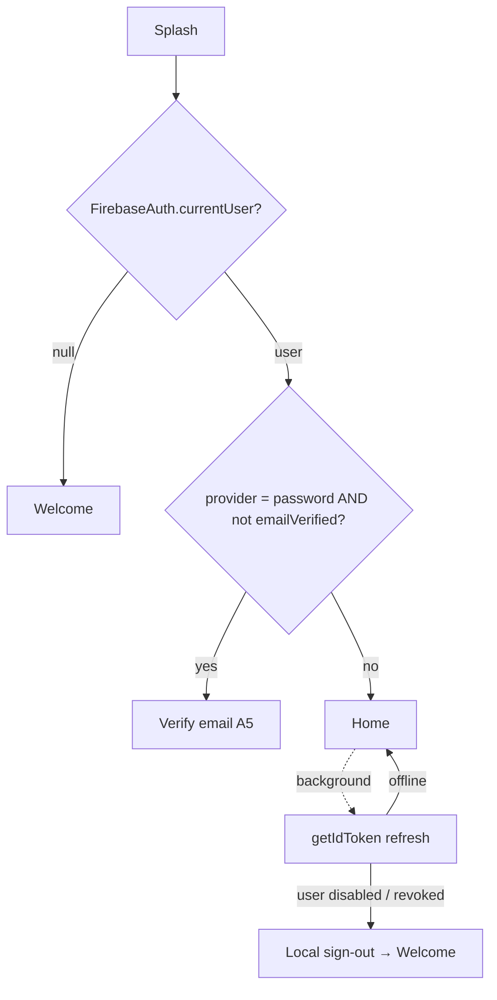
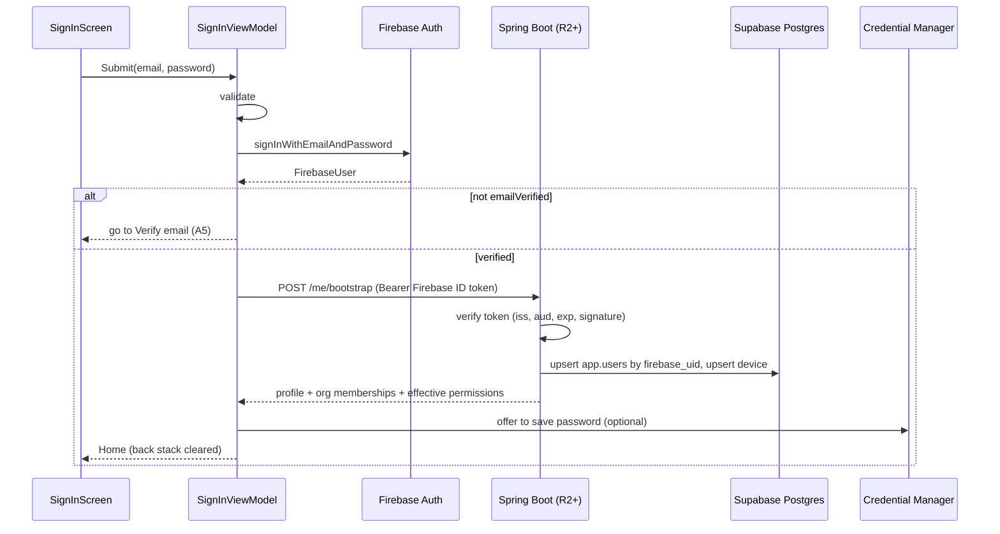
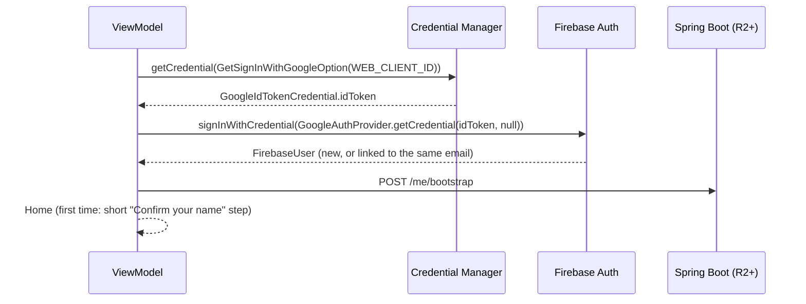

# 04 — Login & Logout Plan (Firebase Auth; Supabase for data only)

Part of Phase 1. Sign-in methods: **email + password** and **Sign in with Google**.

| Concern | Service |
|---|---|
| Login, sessions, verify/reset emails, email callbacks | **Firebase Authentication** (+ Firebase Hosting for the callback page) |
| Push notifications | Firebase Cloud Messaging |
| Database | **Supabase Postgres** (reached only by Spring Boot) |
| Files (receipts, attachments) | **Supabase Storage** (reached through signed URLs the backend creates) |
| Not used | Supabase Auth, Supabase Realtime, Supabase Data API |

The Android app **never holds a Supabase key**. It talks to Firebase (login) and to our Spring
Boot API (everything else).

---

## 1. Decisions

| Topic | Decision | Why |
|---|---|---|
| Identity provider | Firebase Auth with the **Email/Password** and **Google** providers | Firebase handles password storage, brute-force limits and the emails, and sends those emails itself (no SMTP to set up) |
| Google on Android | **Credential Manager** → Google ID token → `GoogleAuthProvider.getCredential(idToken, null)` → `signInWithCredential` | Native account sheet. The old `GoogleSignInClient` is deprecated. |
| Token to our API | The **Firebase ID token** itself (`Authorization: Bearer …`), from `user.getIdToken(false)` | The Firebase SDK refreshes it every hour. No session system of our own to build. |
| Backend check | Spring Security verifies the token: Google public keys, `iss = https://securetoken.google.com/<projectId>`, `aud = <projectId>`, expiry | Standard and stateless |
| Email callbacks | Custom **action URL** on Firebase Hosting `https://<project>.web.app/auth/action`, set up as an Android **App Link** | Verify/reset links open **inside the app**. If the app isn't installed, the same page completes the action in the browser. (Firebase Dynamic Links shut down in 2025, so we don't use them.) |
| Email verification | Required **before first use** for email/password accounts. Google accounts are already verified. | Stops someone registering another person's email. Safe group invites. |
| One account per email | Firebase setting "Link accounts that use the same email" | The same person using Google one day and a password the next ends up with one account |
| Email enumeration protection | **ON** (Firebase default) | Wrong email and wrong password give the same error |
| Abuse | **App Check** with Play Integrity + Firebase rate limits; backend rate limits | Blocks scripted sign-ups and password guessing |
| Local storage of auth | Firebase keeps its own session. Our extra data (userId, deviceId) goes in DataStore encrypted with Tink. **Passwords are never stored by the app.** | Spec §22 |
| Logout everywhere | Backend calls Firebase Admin `revokeRefreshTokens(uid)` and sets `users.tokens_valid_after` | Other devices can't refresh, and their current ID token is rejected straight away |

---

## 2. Screens

| # | Screen | Route | Purpose |
|---|---|---|---|
| A1 | Splash | `auth/splash` | Reads `FirebaseAuth.currentUser`, routes to Home / Verify / Welcome |
| A2 | Welcome | `auth/welcome` | "Continue with Google", "Sign in with email", "Create account" |
| A3 | Sign in | `auth/sign-in` | Email + password, show/hide, "Forgot password?", Google button |
| A4 | Create account | `auth/sign-up` | Name, email, password + strength meter, confirm, terms checkbox, Google button |
| A5 | Verify email | `auth/verify` | "We sent a link to x@y". Open mail app, Resend (60 s cooldown), Change email, Sign out. Moves on by itself when verified. |
| A6 | Forgot password | `auth/forgot` | Email field → reset link. Same message whether or not the email exists. |
| A7 | Set new password | `auth/reset?oobCode=…` | Opened by the reset link (App Link); new password + confirm |
| A8 | Logout confirm | dialog in Settings/Profile | Unsynced-changes warning, then sign out |
| A9 | Devices (R2) | `settings/devices` | Devices signed in, "Sign out everywhere" |
| A10 | Change / add password | `settings/password` | Change password (re-authenticate first); a Google-only user can **add** a password (`linkWithCredential`) |

### 2.1 Wireframes

```
A2 Welcome                     A3 Sign in                       A4 Create account
┌──────────────────────┐       ┌──────────────────────────┐     ┌──────────────────────────┐
│        [logo]        │       │ ←  Sign in               │     │ ←  Create account        │
│   Money, bills and   │       │                          │     │ Full name  [__________]  │
│   plans in one app   │       │ Email     [____________] │     │ Email      [__________]  │
│                      │       │ Password  [________] 👁  │     │ Password   [______] 👁   │
│ [G  Continue with    │       │            Forgot pass?  │     │ ▓▓▓▓░░ Medium            │
│      Google       ]  │       │ [      Sign in       ]   │     │ Confirm    [______]      │
│ [ Sign in with email]│       │ ──────── or ────────     │     │ ☐ I agree to Terms &     │
│                      │       │ [G Continue with Google] │     │   Privacy Policy         │
│ New here? Create     │       │                          │     │ [   Create account   ]   │
│ account              │       │ No account? Create one   │     │ ──────── or ────────     │
└──────────────────────┘       └──────────────────────────┘     │ [G Continue with Google] │
                                                                └──────────────────────────┘
A5 Verify email                              A8 Logout confirm (unsynced changes)
┌──────────────────────────────┐             ┌────────────────────────────────────────────┐
│        ✉                     │             │ Sign out?                                  │
│ Verify your email            │             │ 3 changes haven't synced yet. If you sign  │
│ We sent a link to            │             │ out now they will be lost.                 │
│ ravi@example.com             │             │                                            │
│ [   Open mail app   ]        │             │ [Cancel] [Sync and sign out] [Sign out anyway] │
│ Resend in 0:42 · Change email│             └────────────────────────────────────────────┘
│ Wrong account? Sign out      │
└──────────────────────────────┘
```

Style follows `05-DESIGN-AND-STORAGE.md` (deep green primary, Material 3). Rules: spinner +
disabled buttons while a call runs, IME Next/Done chaining, autofill `ContentType.EmailAddress` /
`Password` / `NewPassword`, errors under the field, 48 dp targets, 200 % font scale, TalkBack labels.

---

## 3. Validation & messages

| Field | Rule |
|---|---|
| Email | Trimmed, lowercase, valid format, ≤ 254 chars |
| Password | 8–64 chars, letters + digits; Firebase **password policy** set to match (enforced server-side too). Not equal to the email. |
| Name | 1–60 chars → `updateProfile(displayName)` and sent in `/me/bootstrap` |
| Confirm / Terms | Must match / must be ticked |

| Firebase result | Message |
|---|---|
| `ERROR_INVALID_CREDENTIAL` (wrong email **or** password, enumeration protection on) | "Incorrect email or password. Signed up with Google? Use Continue with Google." |
| `ERROR_EMAIL_ALREADY_IN_USE` | "An account with this email already exists. Sign in instead?" |
| `ERROR_WEAK_PASSWORD` / `ERROR_PASSWORD_DOES_NOT_MEET_REQUIREMENTS` | Field hint listing the missing rule |
| `ERROR_TOO_MANY_REQUESTS` | "Too many attempts. Try again in a few minutes." |
| `ERROR_USER_DISABLED` | "This account is disabled. Contact support." |
| `ERROR_EXPIRED_ACTION_CODE` / `ERROR_INVALID_ACTION_CODE` | "This link has expired or was already used. Send a new one." |
| `ERROR_REQUIRES_RECENT_LOGIN` (change password) | Ask for the current password, then retry |
| `FirebaseNetworkException` | "No internet connection." + Retry |
| Credential Manager `GetCredentialCancellationException` | Silent (user closed the sheet) |
| Credential Manager `NoCredentialException` | "No Google account on this device." + Add account |

---

## 4. Flows

### 4.1 App start



`currentUser` is read from local storage, so start-up never waits on the network (offline-first).

### 4.2 Email sign-in



### 4.3 Google sign-in



### 4.4 Sign-up and the verification callback

```mermaid
sequenceDiagram
    participant App
    participant FA as Firebase Auth
    participant Mail as User's inbox
    participant Link as https://<project>.web.app/auth/action
    App->>FA: createUserWithEmailAndPassword
    App->>FA: updateProfile(displayName)
    App->>FA: sendEmailVerification(ActionCodeSettings{url = app continue URL})
    App-->>App: show Verify email (A5)
    Mail->>Link: user taps link (?mode=verifyEmail&oobCode=…)
    alt app installed (App Link)
        Link->>App: MainActivity receives link
        App->>FA: applyActionCode(oobCode)
        App->>FA: currentUser.reload() → emailVerified = true
        App->>App: POST /me/bootstrap → Home
    else app not installed / opened on PC
        Link->>FA: hosted page applies code (Firebase JS SDK)
        Note over App: when the user returns, A5 onResume → reload() → Home
    end
```

### 4.5 Forgot password callback

A6 → `sendPasswordResetEmail(email, actionCodeSettings)` → always show "If an account exists, we've
sent a link" → link `…/auth/action?mode=resetPassword&oobCode=…`:
- **App installed:** opens A7 → `verifyPasswordResetCode(oobCode)` (shows the email) →
  `confirmPasswordReset(oobCode, newPassword)` → sign in with the new password → Home.
- **Browser:** the hosted page shows a new-password form and does the same with the JS SDK.

Firebase revokes older sessions after a password reset, so other devices are signed out on their
next token refresh.

`mode=recoverEmail` (undoing an email change) is handled by the same activity/page.

### 4.6 Logout

```mermaid
flowchart TD
    T[Tap Sign out] --> U{Unsynced pending_ops?}
    U -- no --> C[Confirm dialog]
    U -- yes --> D[Sync and sign out / Sign out anyway / Cancel]
    D -- Sync and sign out --> SY[Run sync, max 15 s] --> X
    D -- Sign out anyway --> X
    C -- confirm --> X[SignOutUseCase]
    X --> X1[DELETE /me/devices/{deviceId}: remove FCM token — best effort]
    X1 --> X2[FirebaseMessaging.deleteToken]
    X2 --> X3[FirebaseAuth.signOut + CredentialManager.clearCredentialState]
    X3 --> X4[Cancel WorkManager jobs, reminder alarms, notifications]
    X4 --> X5[Delete encrypted prefs; close Room; delete DB file + key; clear caches]
    X5 --> W[Welcome, back stack cleared]
```

- Local data is wiped so the next person on the phone can't see the previous user's money.
  **R1 (data only on the phone):** the dialog offers **Back up** / **Sign out and delete data** / **Cancel**.
- `clearCredentialState` stops Google from signing the same account straight back in.
- **Sign out everywhere (R2):** `POST /auth/logout-all` → backend runs `revokeRefreshTokens(uid)` and
  sets `tokens_valid_after = now()`. Other devices get 401 → local sign-out.
- **Forced logout:** account disabled, or tokens revoked → `getIdToken` fails or the backend returns
  401 → local sign-out + "You've been signed out for security".

---

## 5. Android low-level design

### 5.1 Files

```
feature/auth/
  navigation/AuthNavigation.kt       routes: Splash, Welcome, SignIn, SignUp, Verify, Forgot, Reset
  splash/ welcome/ signin/ signup/ verify/ forgot/ reset/   (Screen + ViewModel + UiState each)
  (App Link entry is MainActivity → AppViewModel.handleLink: mode = verifyEmail | resetPassword | recoverEmail)
  components/GoogleSignInButton.kt  PasswordField.kt  PasswordStrengthMeter.kt  AuthErrorText.kt

core/domain/auth/
  AuthRepository.kt  SessionState.kt  AuthError.kt
  SignInWithEmailUseCase  SignUpWithEmailUseCase  SignInWithGoogleUseCase
  SendPasswordResetUseCase  ConfirmPasswordResetUseCase  ApplyEmailActionUseCase
  ResendVerificationUseCase  SignOutUseCase  ObserveSessionUseCase  ValidateCredentialsUseCase

core/data/auth/
  AuthRepositoryImpl.kt
  FirebaseAuthDataSource.kt          suspend wrappers (kotlinx-coroutines-play-services await())
  GoogleIdTokenProvider.kt           Credential Manager
  AuthErrorMapper.kt                 FirebaseAuthException / CredentialException → AuthError

core/network/
  FirebaseTokenInterceptor.kt        adds Bearer getIdToken(false)
  TokenAuthenticator.kt              on 401: one forced refresh getIdToken(true) (Mutex), retry once, else sign out

core/security/
  SecurePrefs.kt                     Tink-encrypted DataStore (userId, deviceId)
  LocalDataWiper.kt
```

### 5.2 Key code

```kotlin
sealed interface SessionState {
    data object Loading : SessionState
    data object SignedOut : SessionState
    data class NeedsVerification(val email: String) : SessionState
    data class SignedIn(val uid: String, val email: String?, val name: String?) : SessionState
}

class FirebaseAuthDataSource @Inject constructor(private val auth: FirebaseAuth) {

    val session: Flow<SessionState> = callbackFlow {
        val listener = FirebaseAuth.AuthStateListener { trySend(it.currentUser.toSession()) }
        auth.addAuthStateListener(listener)
        awaitClose { auth.removeAuthStateListener(listener) }
    }.distinctUntilChanged()

    suspend fun signInWithEmail(email: String, password: String): FirebaseUser =
        auth.signInWithEmailAndPassword(email, password).await().user!!

    suspend fun signInWithGoogle(idToken: String): FirebaseUser =
        auth.signInWithCredential(GoogleAuthProvider.getCredential(idToken, null)).await().user!!

    suspend fun signUp(name: String, email: String, password: String): FirebaseUser {
        val user = auth.createUserWithEmailAndPassword(email, password).await().user!!
        user.updateProfile(userProfileChangeRequest { displayName = name }).await()
        user.sendEmailVerification(actionCodeSettings()).await()
        return user
    }

    suspend fun applyVerifyCode(oobCode: String) {
        auth.applyActionCode(oobCode).await()
        auth.currentUser?.reload()?.await()
    }

    private fun actionCodeSettings() = actionCodeSettings {
        url = BuildConfig.AUTH_CONTINUE_URL            // https://<project>.web.app/auth/done
        setAndroidPackageName(BuildConfig.APPLICATION_ID, true, null)
        handleCodeInApp = false                         // verify/reset use the custom action URL
    }

    private fun FirebaseUser?.toSession(): SessionState = when {
        this == null -> SessionState.SignedOut
        providerData.any { it.providerId == EmailAuthProvider.PROVIDER_ID } && !isEmailVerified ->
            SessionState.NeedsVerification(email.orEmpty())
        else -> SessionState.SignedIn(uid, email, displayName)
    }
}

class GoogleIdTokenProvider @Inject constructor() {
    suspend fun get(activity: Activity): String {
        val option = GetSignInWithGoogleOption.Builder(BuildConfig.GOOGLE_WEB_CLIENT_ID).build()
        val result = CredentialManager.create(activity)
            .getCredential(activity, GetCredentialRequest.Builder().addCredentialOption(option).build())
        val cred = result.credential
        require(cred is CustomCredential && cred.type == GoogleIdTokenCredential.TYPE_GOOGLE_ID_TOKEN_CREDENTIAL)
        return GoogleIdTokenCredential.createFrom(cred.data).idToken
    }
}
```

### 5.3 Manifest (email callback App Link)

```xml
<activity android:name=".MainActivity" android:exported="true"
          android:launchMode="singleTask" android:theme="@style/Theme.DailyMoney.Starting">
    <intent-filter android:autoVerify="true">
        <action android:name="android.intent.action.VIEW" />
        <category android:name="android.intent.category.DEFAULT" />
        <category android:name="android.intent.category.BROWSABLE" />
        <data android:scheme="https" android:host="<project>.web.app" android:pathPrefix="/auth/action" />
    </intent-filter>
</activity>
```

Firebase Hosting serves `/.well-known/assetlinks.json` (release + debug SHA-256) so Android opens
the app without asking. The same `/auth/action` page is a small web page (Firebase JS SDK) for
when the app isn't installed. `MainActivity` (via `AppViewModel.handleLink`) reads `mode` + `oobCode`, runs the matching use
case and forwards to `MainActivity` with the result (Home or A7).

Navigation: two graphs (`authGraph`, `mainGraph`) picked from `ObserveSessionUseCase`, switched
with `popUpTo(0){inclusive=true}`; `installSplashScreen().setKeepOnScreenCondition { loading }`.

### 5.4 Dependencies

Firebase BoM → `firebase-auth`, `firebase-messaging`, `firebase-appcheck-playintegrity`;
`kotlinx-coroutines-play-services`; `androidx.credentials:credentials`,
`credentials-play-services-auth`; `com.google.android.libraries.identity.googleid:googleid`;
`androidx.core:core-splashscreen`; `com.google.crypto.tink:tink-android`; `androidx.biometric` (optional).
**No Supabase SDK in the app.**

---

## 6. Backend (Spring Boot) — Firebase in, Supabase behind

```yaml
spring.security.oauth2.resourceserver.jwt:
  issuer-uri:  https://securetoken.google.com/${FIREBASE_PROJECT_ID}
  jwk-set-uri: https://www.googleapis.com/service_accounts/v1/jwk/securetoken@system.gserviceaccount.com
# + audience validator: aud == FIREBASE_PROJECT_ID
# + email_verified validator for password accounts (claim firebase.sign_in_provider == "password")
# + tokens_valid_after check: token iat must be > users.tokens_valid_after (cached 5 min)

spring.datasource:
  url: jdbc:postgresql://<supabase-pooler-host>:5432/postgres?sslmode=require
  username: ${SUPABASE_DB_USER}
  password: ${SUPABASE_DB_PASSWORD}
supabase.storage:
  url: https://<project-ref>.supabase.co/storage/v1
  service-key: ${SUPABASE_SERVICE_ROLE_KEY}      # server only
  bucket: attachments
firebase.admin.credentials: ${FIREBASE_SERVICE_ACCOUNT_JSON}   # server only
```

| Endpoint | Behaviour |
|---|---|
| `POST /me/bootstrap` | `uid` from the token → upsert `app.users` (firebase_uid, email, email_verified, providers, name), upsert device + FCM token, seed default categories on first call, return profile + memberships + effective permissions. Idempotent. |
| `DELETE /me/devices/{deviceId}` | Clears the FCM token at logout |
| `GET /me/devices` | Devices list for A9 |
| `POST /auth/logout-all` | Firebase Admin `revokeRefreshTokens(uid)` + `tokens_valid_after = now()` |
| `DELETE /me` | Spec §22: anonymise org expenses, delete personal rows and Storage files, then Firebase Admin `deleteUser(uid)` |

### 6.1 Files through Supabase Storage (no Supabase keys on the phone)

```mermaid
sequenceDiagram
    participant App
    participant BE as Spring Boot
    participant ST as Supabase Storage (private bucket)
    App->>BE: POST /attachments {entityType, entityId, mime, size, sha256}
    BE->>BE: authorize access to the parent entity; check mime/size
    BE->>ST: createSignedUploadUrl(path = userId/uuid.webp)
    BE-->>App: {attachmentId, uploadUrl (valid 2 h)}
    App->>ST: PUT file to uploadUrl
    App->>BE: POST /attachments/{id}/complete
    Note over App,BE: Download: GET /attachments/{id}/url → authz → createSignedUrl (5 min)
```

Bucket settings: private, max 10 MB, allowed MIME `image/webp, image/jpeg, image/png, application/pdf`.

*(Supabase also supports "third-party auth" with Firebase, which would let the app call Supabase
directly with its Firebase token. We don't need it, because all data access goes through the backend.)*

---

## 7. Setup checklist (one-time)

**Firebase console**
1. Create a project and add the Android app (package name).
2. Authentication → Sign-in method: enable **Email/Password** and **Google**.
3. Settings → User account linking: **one account per email**. Email enumeration protection: **on**.
4. Password policy: min 8, require letters + digits, enforce.
5. Templates → Email address verification / Password reset: set sender name, app name, and the **custom action URL** `https://<project>.web.app/auth/action`.
6. Authorized domains: `<project>.web.app` (plus your own domain later).
7. Project settings → add SHA-1 **and** SHA-256 for the debug key, the upload key and the **Play App Signing key** (Google sign-in fails in the Play build without the last one).
8. Copy the **Web client ID** (auto-created OAuth client of type "Web") → `GOOGLE_WEB_CLIENT_ID`. Not the Android client ID.
9. App Check → Play Integrity, start in monitor mode, enforce before launch.
10. Hosting: deploy the `/auth/action` page + `/.well-known/assetlinks.json`.
11. Service account key (JSON) for the backend Admin SDK. Keep it in server env/secret store only.
12. Download `google-services.json` (keep out of git for release; inject in CI).

**Google Cloud console** (same project)
13. OAuth consent screen: app name, support email, privacy policy URL, logo.

**Supabase (data only)**
14. Create the project (region close to users, e.g. Mumbai `ap-south-1`).
15. Settings → API: remove `public` from exposed schemas, or leave it empty (no Data API use). Disable "Auth" sign-ups (not used).
16. Storage: create the private bucket `attachments` with the size/MIME limits above.
17. Note the pooler connection string, DB password and service-role key → backend secrets only.

**Project**
18. `local.properties` → `GOOGLE_WEB_CLIENT_ID`, `AUTH_CONTINUE_URL`. No Supabase values in the app.

---

## 8. Tests

| Area | Cases |
|---|---|
| Validation | Bad email, short password, password = email, mismatched confirm, terms unticked |
| ViewModels (Turbine) | Buttons disabled while submitting; every `AuthError` → right message; navigation emitted once |
| Error mapper | Every Firebase / Credential Manager exception in §3 |
| Google | Cancel is silent; no account → prompt; existing email account is linked, not duplicated |
| Email callbacks | Verify link (app installed) → Home; verify in browser → A5 picks it up on resume; reset link → A7 → new password works; used/expired link → "Send a new one" |
| Session | Splash: none / unverified / verified / disabled / offline |
| Token refresh | Parallel 401s → exactly one forced refresh; revoked → signed out |
| Logout | FCM token deleted, DB file gone, alarms and workers cancelled, Back doesn't reopen Home; unsynced dialog; R1 backup prompt |
| Backend | Expired / wrong-project / tampered token → 401; unverified password account → 403; token older than `tokens_valid_after` → 401; bootstrap idempotent |
| Storage | Upload URL only for an entity the user can see; download URL refused for another user's private expense; oversize / wrong MIME rejected |
| Manual | Play-signed release build: Google sign-in works; App Link opens the app (`adb shell pm get-app-links`) |

---

## 9. Tasks

| # | Task | Est. |
|---|---|---|
| 1 | Firebase setup (Auth, App Check, Hosting action page + assetlinks), Google consent screen, Supabase project + bucket | 1 d |
| 2 | Migration: `app` schema, `app.users` (firebase_uid), devices, attachments | 0.5 d |
| 3 | `:feature:auth` module, nav graphs, splash, email-link handling in `MainActivity` | 1 d |
| 4 | `FirebaseAuthDataSource`, `AuthRepository`, error mapper + tests | 1 d |
| 5 | Sign-in, Sign-up, Verify, Forgot, Set-new-password screens + ViewModels | 2 d |
| 6 | Google sign-in (Credential Manager) + password save + account linking | 1 d |
| 7 | Logout flow (unsynced check, wipe, R1 backup prompt) | 1 d |
| 8 | Spring Boot Firebase token validation, `/me/bootstrap`, logout-all, devices, delete account (R2) | 1.5 d |
| 9 | Interceptor + single-flight authenticator; Supabase Storage signed-URL service (R2) | 1 d |
| 10 | Change/add password, devices screen, optional biometric lock | 1 d |
| 11 | Tests (§8) + Play-signed build check | 1.5 d |
| | **Total** | **≈ 12.5 dev-days** (R1 part: 1, 3–7, 11 ≈ 8.5 d) |
